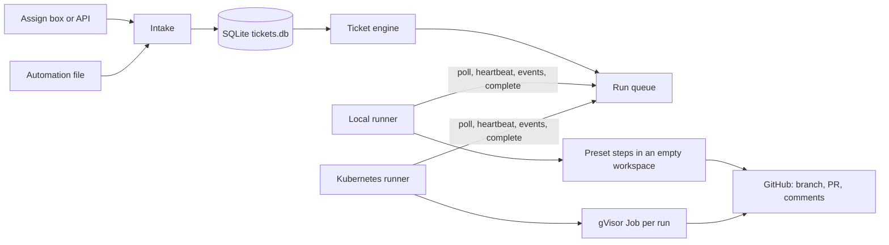

# Architecture

Machinist has one Go control plane with an embedded React UI, and any number of runners.
The UI is read-only: a list of jobs, a page for each job with every step's output, and the
runners. Jobs start through the [run API](docs/run-api.md)
and run headless from start to finish.
The control plane owns tickets, the ledger, schedules, the factory's presets and the UI. It
never runs a step. Runners do, and they dial out, so a runner behind a firewall needs no
inbound route.



## Tickets

A ticket is one piece of work with one preset and one fixed branch,
`machinist/<ticket id>`. Every run runs the preset's steps from the first, in an empty
workspace. The only state carried between runs is what a step pushed and the ticket log.
No run waits for a person: an agent that has to guess writes its guess to
`assumptions.md`, and `publish.sh` puts it in the pull request. The run API calls a ticket a job.

The runner turns the steps' outcome into one report. A step that fails fails the run.
Otherwise the report is `no_change`,
with `result.md` as its summary. After a run, the control plane looks up the branch's pull
request, so a step that opens one needs to report nothing. See
[Factory files](docs/factory.md#presets).

| State | Meaning |
| --- | --- |
| `working` | A run is going or about to |
| `pr_ready` | A pull request is open and nothing is running |
| `done` | Finished with no pull request needed |
| `failed` | A step failed, the preset is gone, or the runner was lost three times |
| `cancelled` | Someone cancelled it. Its pull request stays open |

A run whose runner is lost is retried, at most three times in all. Each run has a deadline, the preset's `timeout` or `run_timeout`. Provider spend
limits cap total cost.

The full state table is in the
[design](docs/designs/machinist-redesign.md#ticket-states), and every row has a test.

## Intake

Work comes from the Assign box, the [run API](docs/run-api.md) at `POST /machinist/run` and
automation schedules. The run API shows tickets as jobs. Each
request has a unique source key, so sending one twice has no effect. Machinist does not read
GitHub comments or follow pull requests. A ticket stays `pr_ready` once its pull request is
open.

Only the control plane posts Machinist's own messages, from rows it has stored. A crash
between posting and recording can post a message twice.

## Runners

A runner holds a token and polls only when it has a free slot. Four routes connect it to
the control plane: poll, heartbeat, events and complete. A run has a 10-minute lease stored
in the database and renewed by heartbeats. So runs outlive a control plane restart, and a
lost runner's ticket continues on any other runner once its lease expires.

Each poll also says what the runner is: local or Kubernetes, and its slots. Runs are queued
for the `steps` harness, so a runner from before presets takes none of them.
The control plane stores that with the time of last contact, and heartbeats keep the time
current while every slot is busy. The Runners page reads it with the running runs and the
queue, so it is the same after a control plane restart.

| Runner | Where steps run | Their limits |
| --- | --- | --- |
| Local | Processes with a private home and an allowlisted environment | The OS user and the GitHub login |
| Kubernetes | One gVisor Job per run, through an egress proxy | The Job, the proxy's host list and the GitHub login |

## Credentials and the GitHub login

Steps use `gh` and `git` directly, with the bot's token. They push branches and open pull
requests themselves. Model and tracker credentials live on runners, never on the control
plane. Branch protection and the login's permissions are what limit a step. At startup the control plane refuses a
token that is not the bot's, and warns about an unprotected default branch or admin rights.

## Configuration

Machinist runs from one directory, normally a git repository. `config.yaml`, `runner.yaml`
and `factory/` (presets, prompts and scripts) are committed there. `.machinist/` beside them
holds the database, tokens and workspaces, and git ignores it. Commands read the config in
the current directory unless `--config` names one, and relative paths resolve from the
config file's directory. Secrets come from the environment, never from these files. Every
run carries the factory's `prompts/` and `scripts/` in its request, so a step can use them
on any runner.

## Packages

```text
internal/tickets       tickets, runs, tokens, ledger, in SQLite
internal/engine        the state table, run queue, leases and posted messages
internal/sources       schedules and the one intake path
internal/ghclient      gh, with no shell
internal/factory       loads presets and automations from files
internal/controlplane  HTTP routes, sign-in and the embedded UI
internal/agentrunner   the runner daemon, and the local and Kubernetes executors
internal/kuberunner    gVisor Jobs, egress proxy and the code that runs in the Job
internal/runner        workspaces, steps, process supervision and the event log
```
