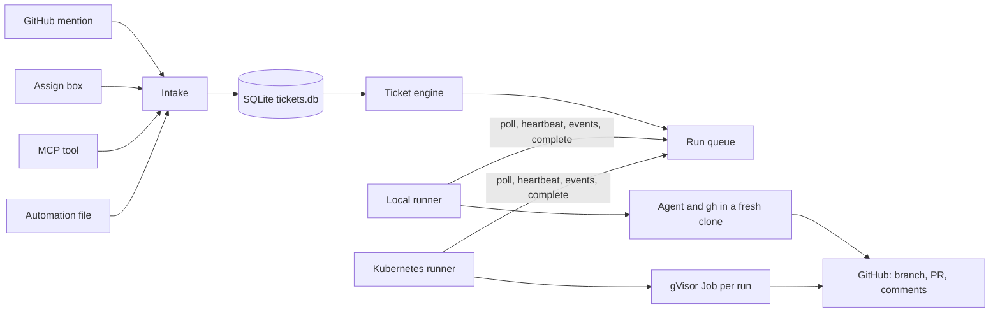

# Architecture

Machinist has one Go control plane with an embedded React UI, and any number of runners.
The control plane owns tickets, the ledger, GitHub polling, the UI and MCP. It never starts
an agent. Runners do, and they dial out, so a runner behind a firewall needs no inbound
route.



## Tickets

A ticket is one piece of work with one fixed branch, `machinist/<ticket id>`. Every run
starts from a fresh clone and checks out that branch if it exists. The only state carried
between runs is the pushed branch and the ticket log: the request, agent reports, human
comments and pointers to CI failures. The agent reads the detail with `gh`.

Each run ends with one report: `pr_ready`, `needs_input`, `no_change` or `failed`. After a
run, the control plane looks up the branch's pull request. The agent does not report it,
so a crash or lost runner cannot create a second one.

| State | Meaning |
| --- | --- |
| `working` | An agent is running or about to |
| `needs_you` | Waiting for a person |
| `pr_ready` | A pull request is open and nothing is running |
| `done` | Merged, or finished with no pull request needed |
| `failed` | An automation's run failed. Automations never wait for a person |
| `cancelled` | Someone cancelled it. Its pull request stays open |

A ticket stops and asks a person after `max_turns_without_human` agent runs with no human
input. Each run has a deadline. Provider spend limits cap total cost.

The full state table is in the
[design](docs/designs/machinist-redesign.md#ticket-states), and every row has a test.

## Reviewers

On a ticket's first pull request, the engine queues one run per file in
`factory/reviewers`. A reviewer gets a fresh clone and no subagents, and posts one comment
with `gh`. It is advice. Its result changes no ticket state, and comments by the bot never
start a run.

## Intake

Polling is used because the control plane has a private address that webhooks cannot reach.
Once a minute per repository it reads new comments, and for each open ticket it reads the
pull request's state, reviews and checks. Every piece of intake has a unique source key, so
processing one twice has no effect.

Only the control plane posts Machinist's own messages, from rows it has stored. A crash
between posting and recording can post a message twice.

## Runners

A runner holds a token and polls only when it has a free slot. Four routes connect it to
the control plane: poll, heartbeat, events and complete. A run has a 10-minute lease stored
in the database and renewed by heartbeats. So runs outlive a control plane restart, and a
lost runner's ticket continues on any other runner once its lease expires.

Each poll also says what the runner is: local or Kubernetes, its harnesses and its slots.
The control plane stores that with the time of last contact, and heartbeats keep the time
current while every slot is busy. The Runners page reads it with the running runs and the
queue, so it is the same after a control plane restart.

| Runner | Where the agent runs | Its limits |
| --- | --- | --- |
| Local | A process with a private home and an allowlisted environment | The OS user and the GitHub login |
| Kubernetes | One gVisor Job per run, through an egress proxy | The Job, the proxy's host list and the GitHub login |

## Credentials and the GitHub login

Agents use `gh` directly, with the bot's token. They push branches and open pull requests
themselves. Model credentials live on runners, never on the control plane. Branch protection
and the login's permissions are what limit an agent. At startup the control plane refuses a
token that is not the bot's, and warns about an unprotected default branch or admin rights.

## Packages

```text
internal/tickets       tickets, runs, tokens, ledger, in SQLite
internal/engine        the state table, run queue, leases and posted messages
internal/sources       GitHub polling, schedules and the one intake path
internal/ghclient      gh, with no shell
internal/factory       loads agents, reviewers and automations from files
internal/controlplane  HTTP routes, sign-in and the embedded UI
internal/mcpserver     the five MCP tools
internal/agentrunner   the runner daemon, and the local and Kubernetes executors
internal/kuberunner    gVisor Jobs, egress proxy and the code that runs in the Job
internal/runner        fresh clones, the fixed harness commands and event parsing
```
