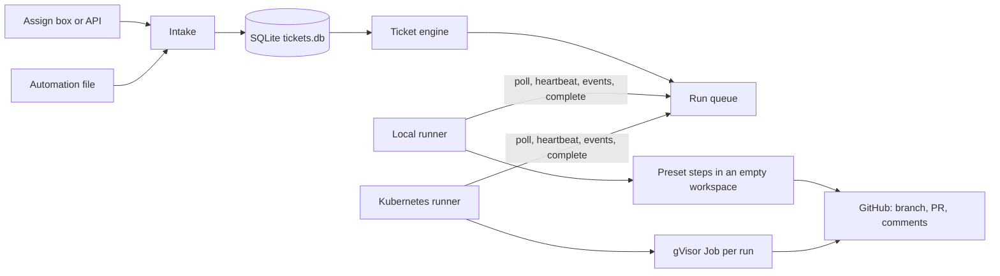

# Architecture

Machinist has one Go control plane with an embedded React UI, and any number of runners.
The UI opens on a dashboard of counts and rates from `GET /api/v1/stats`. It shows the jobs
as a board or a list, a page for each job, the runners, and a Setup page. Setup lists what
is done and what is missing (GitHub, a runner, projects, and Linear, which is optional),
and a new install opens on it until every required step is done. A project is a repository
Machinist works on: one in `github.repositories`, or one added on the Setup page, which is
kept in the `projects` table and takes jobs at once, with no restart. A job's page draws its preset's
steps as a pipeline with each step's state, shows every step's output, and has a **Run again**
button for an ended job. Running a job again adds a comment to its ticket and sets it back to
working, so the engine queues a new attempt on the same branch. The New job form sends the
same `POST /machinist/run` as any other caller. Jobs start through the [run API](docs/run-api.md)
and run headless from start to finish.
The control plane owns tickets, the ledger, schedules, the factory's presets and the UI. It
never runs a step. Runners do, and they dial out, so a runner behind a firewall needs no
inbound route.



## Tickets

A ticket is one piece of work with one preset and one fixed branch,
`machinist/<ticket id>`. Every run runs the preset's steps from the first, in an empty
workspace. The only state carried between runs is what a step pushed and the ticket log.
No run waits for a person: an agent that has to guess writes its guess to
`assumptions.md`, and the publish step puts it in the pull request. The run API calls a ticket a job.

The runner turns the steps' outcome into one report. A step that fails fails the run.
Otherwise the report is `no_change`,
with `result.md` as its summary. After a run, the control plane looks up the branch's pull
request, so a step that opens one needs to report nothing: an open pull request makes the
job `pr_ready`, and a merged one leaves it `done`. `github.auto_merge` reaches every step as
`MACHINIST_AUTO_MERGE`. The shipped preset ends with `machinist merge` (`internal/ship`), which
merges only when it is `true`, the latest review in `review.json` is `accepted` and every check
passed. A missing or invalid `review.json` leaves the pull request open. See
[Factory files](docs/factory.md#presets).

| State | Meaning |
| --- | --- |
| `working` | A run is going or about to |
| `pr_ready` | A pull request is open and nothing is running |
| `done` | Finished with no pull request needed |
| `failed` | A step failed, the preset is gone, or the runner was lost three times |
| `cancelled` | Someone cancelled it. Its pull request stays open |

A run whose runner is lost is retried, at most three times in all. Each run has a deadline, the preset's `timeout` or `run_timeout`. A step that prints nothing for its `idle_timeout`, 15 minutes by default, is stopped, so a hung agent frees its slot. Provider spend
limits cap total cost.

The full state table is in the
[design](docs/designs/machinist-redesign.md#ticket-states), and every row has a test.

## Intake

Work comes from the Assign box, the [run API](docs/run-api.md) at `POST /machinist/run`,
automation schedules and [Linear](docs/linear.md). A tracker such as Linear is a
`sources.Tracker`: a `sources.Poller` asks it for new assignments every minute, starts their
jobs through the same intake, and writes each job's news back once (In Progress with an
acknowledgement, the pull request link, Done on merge, a comment on close, the result when
there is no pull request, or the failure). An allowed person's reply on the issue after a
job ends runs that job again with the reply in its log, so a conversation stays on one job. It cancels a job whose issue leaves Machinist or every started
state. What it has written is in `tracker_reports`, and how far it has read is its cursor. The run API shows tickets as jobs. Each
request has a unique source key, so sending one twice has no effect. Machinist does not read
GitHub comments. A ticket stays `pr_ready` while its pull request is open. Every minute the
engine asks GitHub about the pull request on each `pr_ready` ticket's branch (`engine.CheckPRs`),
and a merge or close moves the ticket to `done` with `pr_state` and `pr_state_at` set. A
tracker is told about the merge or close on its next poll.

Only the control plane posts Machinist's own messages, from rows it has stored. A crash
between posting and recording can post a message twice.

## Runners

A runner holds a token and polls only when it has a free slot. Four routes connect it to
the control plane: poll, heartbeat, events and complete. They need a runner's token, and the
last three check that the run was given to that token's runner. A fifth, github-token, gives
a local runner a new GitHub App token for its run's repository before each step. A person's token cannot use
them. A run has a 10-minute lease stored
in the database and renewed by heartbeats. So runs outlive a control plane restart, and a
lost runner's ticket continues on any other runner once its lease expires.

Each poll also says what the runner is: local or Kubernetes, its slots and its harnesses.
Runs are queued for the `steps` harness, so a runner from before presets takes none of them.
A local runner looks up `agy`, `claude`, `codex` and `pi` on its `PATH` when it starts and
lists the ones it found. The control plane then gives it only runs whose preset's agents
all use a harness it has (`Factory.Needs`, `engine.HasAll`), skipping past runs it cannot
take. Agents with their own `program` and runs whose preset is gone are not matched. A
Kubernetes runner does not look, because its image decides, so it takes any run. The Setup
page flags a preset that no online runner can run.
The control plane stores that with the time of last contact, and heartbeats keep the time
current while every slot is busy. The Runners page reads it with the running runs and the
queue, so it is the same after a control plane restart.

Step output reaches the control plane as events about once a second. `machinist agent`
runs inside a step and turns the harness's event stream into readable lines, one per message
or action, and leaves the tokens and cost the agent reported in `usage.json`. The runner
adds them to the step's result and the run's totals. As events arrive, the control plane
keeps each running run's current step, when it started and the last action line, so the
board can show what every running job is doing without reading its events.

| Runner | Where steps run | Their limits |
| --- | --- | --- |
| Local | Processes with a private home and an allowlisted environment | The OS user and the GitHub login |
| Kubernetes | One gVisor Job per run, through an egress proxy | The Job, the proxy's host list and the GitHub login |

## Credentials and the GitHub login

Steps use `gh` and `git` directly, with the bot's token. They push branches and open pull
requests themselves. With a [GitHub App](docs/github-app.md), the control plane holds the
app's private key and makes a new token for each run when a runner claims it. The token
reaches only that run's repository, lasts an hour, and travels in the run request; the
runner uses it in place of its own `GH_TOKEN`. A local runner asks for a new token before
each step, so only a step must fit in an hour; a Kubernetes pod keeps its first token, so
there the whole run must. The control plane's own GitHub calls use
cached tokens from the same app. Model and tracker credentials live on runners, never on the control
plane. Branch protection and the login's permissions are what limit a step. At startup the control plane refuses a
token that is not the bot's, and warns about an unprotected default branch or admin rights.

## Configuration

Machinist runs from one directory, normally a git repository. `config.yaml`, `runner.yaml`
and `factory/` (presets, prompts and scripts) are committed there. `.machinist/` beside them
holds the database, tokens and workspaces, and git ignores it. Commands read the config in
the current directory unless `--config` names one, and relative paths resolve from the
config file's directory. Secrets come from the environment, never from these files. Every
run carries the factory's `agents/`, `prompts/` and `scripts/` in its request, so a step can
use them on any runner. A step with `agent: <name>` runs `machinist agent <name>`, which
reads the agent file, builds the harness's command (Claude Code, Codex, Pi or agy) and turns
its event stream into live lines and usage.

## Packages

```text
internal/tickets       tickets, runs, tokens, ledger, in SQLite
internal/engine        the state table, run queue, leases and posted messages
internal/sources       schedules and the one intake path
internal/ghclient      gh, with no shell
internal/githubapp     short-lived, one-repository tokens from a GitHub App
internal/factory       loads presets and automations from files
internal/controlplane  HTTP routes, sign-in and the embedded UI
internal/agentrunner   the runner daemon, and the local and Kubernetes executors
internal/kuberunner    gVisor Jobs, egress proxy and the code that runs in the Job
internal/runner        workspaces, steps, process supervision and the event log
internal/harness       agent files, and the Claude Code, Codex and Pi commands and event streams
```
