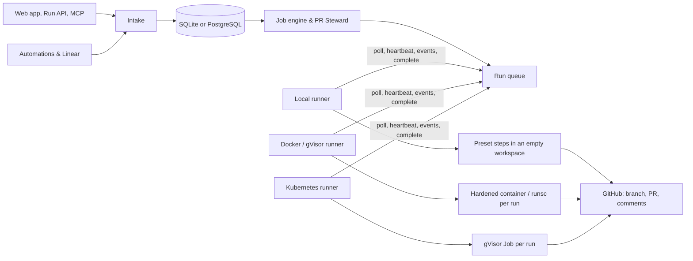

# Architecture

Machinist has one Go control plane with an embedded React UI, and any number of runners.

## Words we use

- **Job:** one piece of work with one preset and one branch (`machinist/<job id>`). The Go code
  and database still call a job a `ticket` (for example in `internal/tickets` and `tickets.db`).
- **Run:** one attempt to execute a job on a runner, from the first step to the last. A job can
  have more than one run when it is retried, rerun, or replied to.
- **Step:** one shell command or agent inside a preset, run in order during a run.
- **Runner:** a daemon that asks the control plane for runs and executes their steps.

## Control plane and UI

The control plane stores jobs, runs, automations, users, tokens, and presets in SQLite or
PostgreSQL (`DATABASE_URL`). It never runs a step. Runners dial out to the control plane, so a
runner behind a firewall needs no inbound route. On Cloud Run, a database `leader_leases` table
ensures only one control-plane revision runs periodic background loops during rolling deploys.

The UI has five top-level sections:

- **Dashboard:** counts, rates, tokens, and cost from `GET /api/v1/stats`.
- **Jobs:** a 4-column board (**Queued**, **Running**, **Review**, **Done**) and a paginated
  list. Auto-merging pull requests waiting on CI stay in **Running** as `Waiting for CI`; pull
  requests waiting for a person appear in **Review** as `Needs you`.
- **Automations:** saved and scheduled jobs from the database or `factory/automations/`, with
  optional cron schedules and harness or model overrides.
- **Runners:** online runners, their harnesses, busy slots, and queue wait times.
- **Settings:** setup checks, projects, GitHub App, Linear, tokens, team and invites (3-role
  RBAC: `admin`, `member`, `viewer`, with optional GitHub OAuth), presets and agents, and
  account. A new install opens on Settings overview until every required check passes.

A project is a repository Machinist works on: listed in `github.repositories` or added in
Settings (stored in the `projects` table, active with no restart). Edits to `config.yaml` or
`factory/` apply live via `machinist reload` (`POST /api/v1/reload`).

A job page shows each step's state (including `Held` on `merge` when waiting for a person), any
merge-gate verdict, and live output for every run. **Run again** adds an entry to the job and
queues a new run on the same branch. The **New job** form sends `POST /machinist/run`. Jobs
start from the web app, [run API](docs/run-api.md), [MCP](docs/mcp.md) (`POST /mcp`),
automations, or [Linear](docs/linear.md), and run headless from start to finish.



## Jobs and runs

A job has one preset and one fixed branch, `machinist/<job id>`. Every run starts at the first
step in an empty workspace. The only state kept between runs is what a step pushed to Git and
the job log. No run waits for a person. When an agent guesses, it writes each guess to
`assumptions.md`, and the publish step puts them in the pull request.

The runner turns the steps' outcome into one report. If any step fails, the run fails.
Otherwise the report is `no_change`, with `result.md` as its summary. After a run, the control
plane checks the branch for a pull request: an open pull request puts the job in `pr_ready`,
and a merged one puts it in `done`.

`github.auto_merge` reaches every step as `MACHINIST_AUTO_MERGE`. The default preset ends with
`merge-gate` and `machinist merge --require-gate` (`internal/ship`). That step posts the merge
gate's verdict on the pull request, saves its `decision`, `risk`, and `reason` on the job,
hands the pull request to the control plane, and ends right away so the runner does not wait on
CI.

Every minute, `engine.CheckPRs` checks each watched pull request. It merges only when
`github.auto_merge` is `true`, `review.json` is `accepted`, `merge-gate.json` approved it as
`low` risk, and all checks pass. If a check fails or a parallel merge causes a conflict
(`DIRTY` or a conflicting branch update), **PR Steward** queues a fix run on the same branch up
to `github.steward_retries` times (default `2`), without overwriting human commits or inflating
human rerun counts. Once steward retries run out (or when set to `0`), a failed check fails the
job and a conflict stays open for a person. A missing or invalid `review.json` or
`merge-gate.json` leaves the pull request open. When `notify.webhook` is set, the engine sends
a Slack-compatible JSON post (with a link from `server.public_url`, never prompt or agent
output) when a job needs a person or fails. See [Factory files](docs/factory.md#presets).

| Internal state | Meaning |
| --- | --- |
| `working` | A run is queued or running |
| `pr_ready` | A pull request is open and no run is active |
| `done` | Finished with no open pull request |
| `failed` | A step failed, the preset is gone, or the runner was lost three times |
| `cancelled` | Someone cancelled the job. Its pull request stays open |

A run whose runner is lost is retried up to three times in all. Each run has a deadline from
the preset's `timeout` or `server.run_timeout`. A step that prints nothing for its
`idle_timeout` (15 minutes by default) is stopped so a hung agent frees its slot. Machinist
records tokens and cost reported by agents, but does not enforce a spend cap. Use your model
provider's spend limits.

The full state table is in the
[earlier design](docs/designs/machinist-redesign.md#ticket-states), and every row has a test.

## Intake

Work comes from the web app (**New job** and **Automations**), the [run API](docs/run-api.md)
(`POST /machinist/run`), [MCP](docs/mcp.md) (`POST /mcp`, using bearer tokens with `read` or
`run` scope), automation schedules, and [Linear](docs/linear.md). Each job records its source
(`web`, `api`, `mcp`, `schedule`, or `linear`) and a link to the original issue when there is
one; see [job sources](docs/designs/issue-sources.md).

A tracker such as Linear implements `sources.Tracker`. `sources.Poller` polls every minute,
starts jobs through the same intake, and reports each milestone back once (In Progress with a
comment, the pull request link, Done on merge, a comment on close, the result when there is no
pull request, or the failure). A reply on the issue from an allowed user after a job ends runs
that job again with the reply in its log. Removing Machinist or moving the issue out of started
states cancels the job. Sent updates live in `tracker_reports`, and the read position is stored
as a cursor.

Each request has a unique source key, so sending it twice has no effect. Machinist does not
read GitHub comments. Every minute `engine.CheckPRs` checks GitHub for the pull request on each
`pr_ready` job's branch. A merge or close moves the job to `done` with `pr_state` and
`pr_state_at` set, and the tracker reports it on the next poll.

Dashboard time-to-merge stats come only from stored timestamps (`pr_opened_at`,
`first_review_at`, `human_reviews`, and `human_touches`). Bot reviews are skipped. Each human
reply or **Run again** adds a row to `human_touches`. Running a merged job again clears these
times so its next pull request is measured fresh.

Only the control plane posts Machinist's own messages, from stored rows. A crash between
posting and recording can post a message twice.

## Runners

A runner holds a runner token and polls only when it has a free slot. Four routes connect it to
the control plane: poll, heartbeat, events, and complete. The last three check that the run
belongs to that runner's token. A fifth route, `github-token`, gives a local runner a fresh
GitHub App token before each step. Operator tokens cannot call runner routes. Each run has a
10-minute lease stored in the database and renewed by heartbeats, so runs outlive control-plane
restarts and a lost runner's job moves to another runner when the lease expires.

Each poll reports the runner kind (`local`, `docker`, `docker (runsc)`, or `kubernetes`), its
slot count, and its harnesses. Runs are queued for the `steps` harness. A local runner checks
`PATH` at startup for `agy`, `claude`, `codex`, and `pi`. A Docker runner probes its image (or
uses `docker.harnesses`). The control plane assigns a run only to a runner that has every
harness the preset's agents need (`Factory.Needs`, `engine.HasAll`). Agents with a custom
`command` and runs whose preset is gone are not matched. A Kubernetes runner leaves harness
choice to its image and takes any run. Settings flags presets that no online runner can run.

Step output streams to the control plane about once a second across local, Docker, and
Kubernetes runners. Inside a step, `machinist agent` turns the harness stream into readable
lines and writes tokens and cost to `usage.json`. The control plane tracks each running run's
current step, start time, and latest action line so the Jobs board can show live progress.

| Runner | Where steps run | Limits |
| --- | --- | --- |
| Local | Processes with a private home and allowlisted env | OS user and GitHub login |
| Docker | Ephemeral hardened container (`--cap-drop=ALL`, `no-new-privileges`, CPU/memory/PIDs caps, optional `runtime: runsc` gVisor) | Container sandbox, optional network/proxy, and GitHub login |
| Kubernetes | One gVisor Job per run, through an egress proxy | Job sandbox, proxy allowlist, and GitHub login |

## Credentials and the GitHub login

Steps use `gh` and `git` directly with the bot's token. With a [GitHub App](docs/github-app.md),
the control plane holds the private key and mints a 1-hour token scoped to that run's
repository alone. A local runner fetches a new token before each step; a Kubernetes pod keeps
its first token for the whole run. The control plane uses cached tokens from the same app for
its own GitHub calls. Runs commit as the app's bot account (`<app-slug>[bot]`). Model and
tracker credentials stay on runners, never on the control plane. Branch protection and token
permissions are what limit a step.

## Configuration

Machinist runs from one directory, normally a git repository. `config.yaml`, `runner.yaml`, and
`factory/` (presets, agents, prompts, scripts, automations) are committed there. `.machinist/`
holds the SQLite database, tokens, and workspaces, and git ignores it. Commands read the config
in the current directory unless `--config` names one, and relative paths resolve from the
config file's directory. Secrets come from the environment or secret files, never from
`config.yaml`. Every run carries `agents/`, `prompts/`, and `scripts/` to the runner. A step
with `agent: <name>` runs `machinist agent <name>`, which builds the command for `claude`,
`codex`, `pi`, or `agy` and formats its stream.

## Packages

```text
internal/cli           CLI commands (init, start, reload, runner, token, invite, user, factory, update, agent, ship)
internal/config        YAML configuration loading and validation for control plane and runners
internal/tickets       jobs (tickets), runs, automations, users, sessions, invites, tokens, leases, in SQLite or PostgreSQL
internal/engine        job state machine, run queue, leases, PR Steward, webhooks and posted messages
internal/ship          merge-gate evaluation, check watcher, branch updates and merge handoff
internal/sources       schedules, Linear poller and the single intake path
internal/ghclient      gh CLI wrapper, with no shell
internal/githubapp     short-lived, one-repository tokens and bot identity from a GitHub App
internal/githubauth    process-scoped GitHub credential environment for runners
internal/factory       loads presets, agents, prompts, scripts, automations and manifests
internal/controlplane  HTTP routes, GitHub OAuth, 3-role RBAC, leader leases, MCP endpoint, live reload and embedded UI
internal/agentrunner   runner daemon and local, Docker and Kubernetes executors
internal/dockerrunner  hardened Docker / gVisor container execution and live event streaming
internal/kuberunner    gVisor Jobs, egress proxy, live event streaming and in-Job sandbox
internal/runner        workspaces, steps, process supervision and the event log
internal/harness       agent files and Claude Code, Codex, Pi and agy commands and stream formatters
internal/protocol      wire types shared between control plane and runners
internal/triggers      cron schedule parsing
internal/updater       self-update for stable and nightly releases
```
