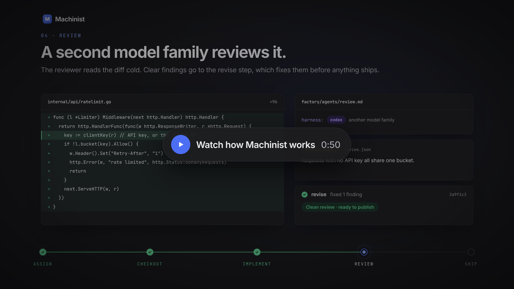

#  Machinist

A job runner for coding agents. Your team assigns work in one place, and every job runs the
same predefined steps on machines you control: a laptop, a VM or Kubernetes. Everyone can
see what is running and what is waiting on a person. It is early-access, open-source
software.

<a href=".github/assets/machinist-explainer.mp4"></a>

- **One place for the team.** One control plane holds every job. Anyone signed in can see
  what each job is doing, step by step, and open its pull request.
- **Runs anywhere.** A runner is a small daemon that asks the control plane for work. Start
  one on a Mac, a VM or a Kubernetes cluster. The control plane treats them all the same.
- **A workflow you define.** A preset is a list of steps: clone, plan, build, test,
  review, open a pull request. A step runs an agent (Claude Code, Codex, Pi or agy, each with
  its own model and prompt) or any shell command. A test
  step is a gate an agent cannot skip.
- **Any trigger.** A tracker, a schedule or `curl` starts a job with one request.

**Supported harnesses:** <picture><source media="(prefers-color-scheme: dark)" srcset=".github/assets/harness-claude-dark.svg"></picture> Claude Code by Anthropic, <picture><source media="(prefers-color-scheme: dark)" srcset=".github/assets/harness-openai-dark.svg"></picture> Codex by OpenAI, <picture><source media="(prefers-color-scheme: dark)" srcset=".github/assets/harness-google-dark.svg"></picture> Antigravity by Google, and Pi. Logos belong to their owners. Machinist is not made by or tied to these companies.

Send the work to the [run API](docs/run-api.md), or let an automation start it. The job works on its own branch, and the default preset opens one pull request.
A job runs headless from start to finish and never stops to ask a question.

See [Vision](VISION.md) for what Machinist is for, where it is, and what comes next.

<a id="quick-start"></a>

## Quick start

This runs the control plane and one runner on your machine. You need Go 1.26.6, Git, the
GitHub CLI signed in with `gh auth login`, and Claude Code signed in. Give the GitHub CLI
the `workflow` scope too, so jobs can push changes to `.github/workflows/`:

```sh
gh auth refresh -s workflow
git clone https://github.com/owainlewis/machinist.git
cd machinist
go build -o ./bin/machinist ./cmd/machinist
export PATH="$PWD/bin:$PATH"
mkdir ../my-machinist && cd ../my-machinist
git init
machinist init
```

Machinist runs from the directory that holds its configuration, so keep that directory in
git and start Machinist there. `init` writes these, all meant to be committed:

```text
config.yaml          the control plane
runner.yaml          a local runner
factory/presets/     the default preset, a short list of steps
factory/agents/      the agents those steps run: harness, model and prompt
factory/prompts/     rules every agent follows
factory/scripts/     the shell those steps run
```

It also makes `.machinist/`, which holds the database and a token for the local runner,
and adds it to `.gitignore`. Run every command below from this directory, or pass
`--config`.

1.  In `config.yaml`, set `handle` to the GitHub login that owns your token,
    which `gh api user --jq .login` prints, and list the repositories jobs may work on.
    Commits are made under that handle:

    ```yaml
    github:
      handle: your-login
      repositories: [owner/name]
    ```

2.  In `runner.yaml`, set `env: []` and uncomment `login: true`, so steps
    use your own Claude Code login. To use an API key instead, keep
    `env: [ANTHROPIC_API_KEY]` and set it in the runner's environment. See
    [Credentials](docs/credentials.md).
3.  Start the control plane in one terminal and the runner in another:

    ```sh
    GH_TOKEN=$(gh auth token) machinist start
    ```

    ```sh
    GH_TOKEN=$(gh auth token) machinist runner start
    ```

4.  Create a token for yourself:

    ```sh
    TOKEN=$(machinist token create "$USER" | tail -n 1)
    ```

5.  Open `http://127.0.0.1:7331`, sign in with the token and select **New job**. Pick the
    repository, type what you want done, and select **Start job**. Claude Code does the
    work, opens a pull request, and merges it once its checks pass. The same from `curl`:

    ```sh
    curl -sS -X POST http://127.0.0.1:7331/machinist/run \
      -H "Authorization: Bearer $TOKEN" \
      -d '{"key":"fix-1","vars":{"repo":"owner/name"},"prompt":"Fix the toast position"}'
    ```

The pull request comes from whoever owns `GH_TOKEN`. For a team, use a
[GitHub App](docs/github-app.md) instead: each run gets a token for its own repository that
lasts an hour, and no runner holds a GitHub token.

To start jobs by assigning Linear issues to Machinist, follow the
[Linear setup guide](docs/linear.md#set-it-up). It makes a Linear app with client
credentials, so Machinist gets and renews its own Linear token.

The production UI is committed, so this build does not need Node.

## Using it

Jobs start from the web app's **New job** form, through the [run API](docs/run-api.md)
from `curl`, a tracker, a webhook or an automation, or when a Linear issue is assigned to
the Machinist app (see [Linear](docs/linear.md)). The web app can also run an ended job again:

| Page | What it does |
| --- | --- |
| Dashboard | Jobs and runs over 7, 14 or 30 days: success rate, run and wait times, tokens, runs per day, and each preset and repository |
| Jobs | Every job as a board of Queued, Running and Done, or as a list with each one's repository, preset, pull request and state |
| New job | Pick a repository, paste a prompt or spec, and start a job. It calls the run API |
| Job | One job: its result, its prompt, its preset's steps drawn as a pipeline with each step's state, and every attempt with the output of each step. **Run again** starts an ended job once more |
| Runners | Each runner, where it runs, how many of its slots are busy and with what, and how long runs have waited |

To stop a job, `POST /machinist/jobs/{id}/cancel`. To run an ended job again,
`POST /machinist/jobs/{id}/rerun`.

Jobs run headless, from start to finish, and never stop to ask a question. When the agent
has to guess, it says so under **Assumptions** in the pull request.

Every job uses the `default` preset unless it names another: clone, have an agent make the
change, review it and fix what the review found, then open one pull request. It merges
once its checks pass when `github.auto_merge` is on, as it is by default. Add a preset to `factory/presets/` only when a kind of job
needs different steps.

### Start jobs from Linear

1. In Linear, create an app called Machinist with client credentials on.
2. Set `LINEAR_CLIENT_ID` and `LINEAR_CLIENT_SECRET` where the control plane runs. In the `linear` section of `config.yaml`, set `app_user_id` (the app's user ID), `projects` or `teams` (Linear project or team to repository) and a non-empty `allowed_users`. Then restart the control plane.
3. Delegate an issue to the Machinist app. Machinist starts a job for it within a minute.

See the [Linear setup guide](docs/linear.md#set-it-up) for each step.

## Testing Machinist itself

```sh
go test ./...
cd internal/controlplane/web && npm ci && npm test
```

The Go tests run whole jobs end to end with fake `claude` and `gh` commands and a local
Git remote. See [Development](docs/development.md).

The default preset has a second agent review the change, fixes what the review found and
reviews it again, then opens a pull request. The `machinist merge` step hands it to the
control plane, which merges it once the repository's checks pass and the review accepted the
change, so no runner waits on CI. That rule is code, so no agent
decides what merges. Set `github.auto_merge: false` to leave every pull request open for a
person. How the pull request is written is in `factory/agents/publish.md`.
Branch protection still decides what can merge. See [Security](SECURITY.md) for what a step
can do.

## How it fits together

One control plane holds jobs and presets. It never runs a step. Any number
of runners, on Macs, VMs or Kubernetes, dial out and ask for work. See
[Architecture](ARCHITECTURE.md).

## Go deeper

| Guide | What it covers |
| --- | --- |
| [Documentation](docs/README.md) | The full list |
| [Vision](VISION.md) | What Machinist is for, where it is, and what comes next |
| [Run API](docs/run-api.md) | Starting jobs from any system |
| [Factory files](docs/factory.md) | Presets and automations |
| [Runners](docs/runners.md) | Adding local and Kubernetes runners |
| [Credentials](docs/credentials.md) | Which credential to use, and why |
| [Configuration](docs/configuration.md) | Every setting |
| [Development](docs/development.md) | Build, test and contribute |

Read [CONTRIBUTING.md](CONTRIBUTING.md) before contributing. Machinist uses the
[MIT License](LICENSE).
