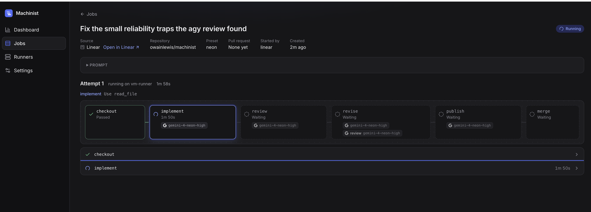
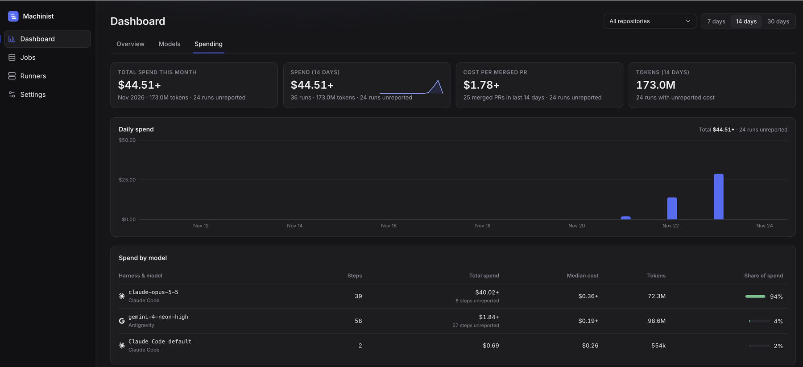

#  Machinist

A job runner for coding agents. Your team assigns work in one place, and every job runs the
same predefined steps on machines you control: a laptop, a VM, Docker (with optional gVisor)
or Kubernetes. Everyone can see what is running and what is waiting on a person. It is
early-access, open-source software.

<a href=".github/assets/machinist-explainer.mp4"></a>

- **One place for the team.** One control plane holds every job. Anyone signed in can see
  what each job is doing, step by step, and open its pull request.
- **Runs anywhere.** A runner is a small daemon that asks the control plane for runs. Start
  one on a Mac, a VM, Docker (with optional gVisor), or Kubernetes. The control plane treats
  them all the same.
- **Steps you define.** A preset is a list of steps: clone, implement, review, revise, open a
  pull request, check risk with a merge gate, and merge. Each step runs an agent (`claude`,
  `codex`, `pi`, or `agy`, with its own model and prompt) or a shell command. A test step is a
  check an agent cannot skip.
- **Any trigger.** The web app (**New job** and **Automations**), [Linear](docs/linear.md), a
  schedule, an [MCP](docs/mcp.md) bot, or `curl` against the [run API](docs/run-api.md).





**Supported harnesses:** <picture><source media="(prefers-color-scheme: dark)" srcset=".github/assets/harness-claude-dark.svg"></picture> Claude Code by Anthropic, <picture><source media="(prefers-color-scheme: dark)" srcset=".github/assets/harness-openai-dark.svg"></picture> Codex by OpenAI, <picture><source media="(prefers-color-scheme: dark)" srcset=".github/assets/harness-google-dark.svg"></picture> Antigravity by Google, and Pi. Logos belong to their owners. Machinist is not made by or tied to these companies.

Send the work to the [run API](docs/run-api.md), or let an automation start it. The job works on its own branch, and the default preset opens one pull request.
A job runs headless from start to finish and never stops to ask a question.

See [Vision](VISION.md) for what Machinist is for, where it is, and what comes next.

## Install

Install the latest stable release for Linux or macOS (`amd64` / `arm64`), verified against the release SHA-256 checksums:

```sh
curl -fsSL https://machinist.sh/install.sh | sh
```

To install the latest automated nightly build from `main` instead:

```sh
curl -fsSL https://machinist.sh/install.sh | MACHINIST_CHANNEL=nightly sh
```

Upgrade an existing install in place:

```sh
machinist update            # latest stable release
machinist update --nightly  # latest nightly build (alias: machinist upgrade)
```

<a id="quick-start"></a>

## Quick start

This runs the control plane and one runner on your machine. You need Go 1.26.6, Git, the
GitHub CLI signed in with `gh auth login`, and Claude Code signed in. Give the GitHub CLI
the `workflow` scope too, so jobs can push changes to `.github/workflows/`:

```sh
gh auth refresh -s workflow
git clone https://github.com/owainlewis/machinist.git
cd machinist
go build -o ./bin/machinist ./cmd/machinist
export PATH="$PWD/bin:$PATH"
mkdir ../my-machinist && cd ../my-machinist
git init
machinist init
```

Machinist runs from the directory that holds its configuration, so keep that directory in
git and start Machinist there. `init` writes these, all meant to be committed:

```text
config.yaml          the control plane
runner.yaml          a local runner
factory/presets/     the default preset, a short list of steps
factory/agents/      the agents those steps run: harness, model and prompt
factory/prompts/     rules every agent follows
factory/scripts/     the shell those steps run
```

It also makes `.machinist/`, which holds the database and a token for the local runner,
and adds it to `.gitignore`. Run every command below from this directory, or pass
`--config`.

1.  In `config.yaml`, set `handle` to the GitHub login that owns your token,
    which `gh api user --jq .login` prints, and list the repositories jobs may work on.
    Commits are made under that handle:

    ```yaml
    github:
      handle: your-login
      repositories: [owner/name]
    ```

2.  In `runner.yaml`, set `env: []` and uncomment `login: true`, so steps
    use your own Claude Code login. To use an API key instead, keep
    `env: [ANTHROPIC_API_KEY]` and set it in the runner's environment. See
    [Credentials](docs/credentials.md).
3.  Start the control plane in one terminal and the runner in another:

    ```sh
    GH_TOKEN=$(gh auth token) machinist start
    ```

    ```sh
    GH_TOKEN=$(gh auth token) machinist runner start
    ```

4.  Create a token for yourself:

    ```sh
    TOKEN=$(machinist token create "$USER" | tail -n 1)
    ```

5.  Open `http://127.0.0.1:7331`, sign in with the token and select **New job**. Pick the
    repository, type what you want done, and select **Start job**. Claude Code does the
    work, opens a pull request, and merges it once its checks pass. The same from `curl`:

    ```sh
    curl -sS -X POST http://127.0.0.1:7331/machinist/run \
      -H "Authorization: Bearer $TOKEN" \
      -d '{"key":"fix-1","vars":{"repo":"owner/name"},"prompt":"Fix the toast position"}'
    ```

The pull request comes from whoever owns `GH_TOKEN`. For a team, use a
[GitHub App](docs/github-app.md) instead: each run gets a token for its own repository that
lasts an hour, and no runner holds a GitHub token.

To start jobs by assigning Linear issues to Machinist, follow the
[Linear setup guide](docs/linear.md#set-it-up). It makes a Linear app with client
credentials, so Machinist gets and renews its own Linear token.

The production UI is committed, so this build does not need Node.

## Using it

Jobs start from the web app (**New job** or **Automations**), the [run API](docs/run-api.md),
[MCP](docs/mcp.md), a schedule, or [Linear](docs/linear.md). Each job runs headless from start
to finish. When an agent has to guess, it lists each guess under **Assumptions** in the pull
request.

| Page | What it does |
| --- | --- |
| Dashboard | Counts and rates over 7, 14, or 30 days: time to merge, human touches, pull requests opened and merged, success rate, run and wait times, tokens, cost, and runs per day |
| Jobs | Every job as a 4-column board (**Queued**, **Running**, **Review**, **Done**) or list, with repository, preset, pull request, state (`Waiting for CI` or `Needs you`), and merge-gate risk badge (`Low`, `Medium`, `High`) |
| Automations | Saved and scheduled jobs from the database or `factory/automations/`. Create, edit, and run them on demand, as-is or with one-off prompt, harness, or model overrides |
| New job | Pick a repository, choose a preset, write a prompt, and start a job |
| Job | One job: result, merge-gate verdict and reason, prompt, steps and their status (including `Held` when waiting for a person), and every run with live step output. **Run again** starts an ended job again |
| Runners | Each runner (`local`, `docker`, `docker (runsc)`, or `kubernetes`), its harnesses, busy slots, and queue wait times |
| Settings | Setup checks, projects (repositories), GitHub App, Linear, tokens (including `read` and `run` scopes), team and invites, presets and agents, and account |

To stop a job, call `POST /machinist/jobs/{id}/cancel`. To run an ended job again, call
`POST /machinist/jobs/{id}/rerun`. After editing `config.yaml` or `factory/`, run
`machinist reload` to apply changes without restarting the control plane. Set `notify.webhook`
and `server.public_url` in `config.yaml` to send a Slack-compatible webhook when a job needs a
person or fails.

Every job uses the `default` preset unless it names another: `checkout`, `implement`,
`review`, `revise`, `publish`, `merge-gate`, and `merge`. When `github.auto_merge` is `true`
(the default), a pull request merges once its checks pass, `review` accepts it, and
`merge-gate` marks it `low` risk. Medium- or high-risk pull requests stay open in **Review**
for a person. Auto-merging pull requests waiting on checks show `Waiting for CI`. If CI fails
or a parallel merge causes a conflict, **PR Steward** starts a fix run on the same branch up to
`github.steward_retries` times (default `2`), without overwriting human commits. Commit
`.machinist/merge-policy.md` to a repository's default branch to override
`factory/prompts/merge-policy.md`. Set `github.auto_merge: false` for **observe mode**:
`merge-gate` still comments its verdict on every pull request, and leaves every pull request
open for a person. See [Merge gate and policy](docs/factory.md#merge-gate-and-policy) and
[Merge policies](docs/merge-policies.md). Add a preset to `factory/presets/` only when a job
needs different steps.

### Start jobs from Linear

1. In Linear, create an app called Machinist with client credentials on.
2. Set `LINEAR_CLIENT_ID` and `LINEAR_CLIENT_SECRET` where the control plane runs. In the `linear` section of `config.yaml`, set `app_user_id` (the app's user ID), `projects` or `teams` (Linear project or team to repository) and a non-empty `allowed_users`. Then run `machinist reload` (or restart the control plane if you changed environment variables).
3. Delegate an issue to the Machinist app. Machinist starts a job for it within a minute.

See the [Linear setup guide](docs/linear.md#set-it-up) for each step.

## Testing Machinist itself

```sh
go test ./...
cd internal/controlplane/web && npm ci && npm test
```

The Go tests run whole jobs end to end with fake `claude` and `gh` commands and a local
Git remote. See [Development](docs/development.md).

The default preset runs `review` with a second agent, runs `revise` to fix what `review` found
and reviews again, opens one pull request in `publish`, and runs `merge-gate` without GitHub
credentials to judge risk against `.machinist/merge-policy.md` on the default branch (or
`factory/prompts/merge-policy.md`). Then `machinist merge` posts the merge-gate comment and
hands the pull request to the control plane, so the runner does not wait on CI. The control
plane merges it only when `github.auto_merge` is `true`, `review` accepted it, `merge-gate`
approved it as `low` risk, and all checks pass. That merge rule is Go code, not an agent. How
the pull request is written is in `factory/agents/publish.md`. Branch protection still decides
what can merge. See [Security](SECURITY.md).

## How it fits together

One control plane holds jobs, runs, and presets, backed by SQLite or PostgreSQL. It never runs
a step. Runners on Macs, VMs, Docker (with optional gVisor), or Kubernetes dial out and ask for
runs. See [Architecture](ARCHITECTURE.md).

## Go deeper

| Guide | What it covers |
| --- | --- |
| [Documentation](docs/README.md) | The full list |
| [Vision](VISION.md) | What Machinist is for, where it is, and what comes next |
| [Run API](docs/run-api.md) | Starting jobs from any system |
| [MCP](docs/mcp.md) | Letting bots list, run, watch and cancel jobs over MCP |
| [Factory files](docs/factory.md) | Presets, agents, merge gate, PR Steward and automations |
| [Merge policies](docs/merge-policies.md) | Risk-based merge policies and starter templates |
| [Runners](docs/runners.md) | Adding local, Docker (with optional gVisor), and Kubernetes runners |
| [Credentials](docs/credentials.md) | Which credential to use, and why |
| [Configuration](docs/configuration.md) | Every setting (including auth, PostgreSQL, live reload, webhooks and PR Steward) |
| [VM deployment](docs/vm-deployment.md) | Running and upgrading on a Linux VM |
| [Cloud Run deployment](docs/cloud-run.md) | Running on Google Cloud Run with PostgreSQL |
| [Development](docs/development.md) | Build, test and contribute |

Read [CONTRIBUTING.md](CONTRIBUTING.md) before contributing. Machinist uses the
[MIT License](LICENSE).
