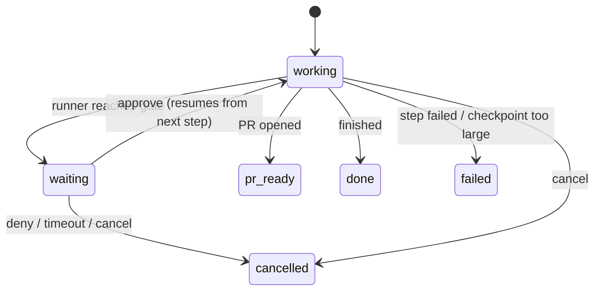

# Engineering Spec: Gates, Preset Inputs, and Triggers

* **Author:** Owain Lewis
* **Status:** Proposed
* **Date:** 2026-11-27
* **Issues:** ENG-247 (Slices: ENG-248 through ENG-255)
* **Baseline:** Machinist `main` (`92d88c84`, including runner labels/`runs_on` from ENG-242 and workspace checkpoints/`RerunFromStep` from ENG-243)

--------------------------------------------------------------------------------

## Summary

This specification adds three cohesive capabilities to Machinist presets while preserving Machinist's linear step model:

1. **Preset inputs (`inputs`):** Named, validated string parameters declared on presets (beyond `repo`), exposed as `MACHINIST_INPUT_<NAME>` across the Run API, New job form, file- and DB-backed automations, MCP, and triggers.
2. **Human approval gates (`gate` steps):** A step that snapshots workspace state using Machinist's existing checkpoint mechanism, frees the runner slot, pauses the job in `waiting`, and resumes from the step after the gate on approval (or cancels on deny/timeout).
3. **Linked job triggers (`trigger` steps and `on_merge`):** Start downstream presets as linked child jobs—either from a step or automatically when a job's pull request merges (passing `MACHINIST_MERGE_SHA`).

| Addition | What it does | Built on (on `main` today) |
| --- | --- | --- |
| `inputs` | Named variables a preset declares beyond `repo` | Replaces single `repoVar` in `internal/sources/run.go` |
| `gate` step | Saves a workspace checkpoint, frees the runner, and pauses until approved/denied/timed out | `internal/runner/checkpoint.go`, `protocol.Checkpoint`, `run_checkpoints`, `Store.RerunFromStep` (ENG-243) |
| `extends` placement | Optional `before:` / `after:` on new steps in child presets | `resolvePresets` in `internal/factory/factory.go` |
| `trigger` step | Records downstream preset starts executed by the control plane on run end/pause | Control plane `sources.Intake` + `runs_on` host targeting (ENG-242) |
| `on_merge` | Starts one or more downstream presets once this job's pull request merges | Control plane merge watch (`internal/engine/pulls.go`) + `ghclient` |

## Goals & Non-Goals

### Goals

* Let a person approve or deny anywhere in a preset (spec approval before implementation, staging check before production) without holding a runner slot.
* Isolate credentials cleanly across stages by chaining presets with different `runs_on` labels (already shipped in ENG-242).
* Work uniformly across **local, Docker, and Kubernetes runners** (sandboxed containers/pods never require inbound or mid-run network access to the control plane).
* Support both **SQLite** and **PostgreSQL** (`schema_migrations` v5–v7) and leader-elected background loops (`leader_leases`).
* Keep every existing preset (`default`) and zero-config quickstart unchanged.

### Non-Goals

* No loops, branches, parallel steps, or DAG syntax. A preset remains a straight list of steps.
* No mid-step agent Q&A. A gate sits between steps.
* No rename of presets to pipelines.
* No changes to the shipped `default` preset.
* No dedicated Slack OAuth app or SMTP mailer in v1 (`notify.webhook` already emits a Slack-compatible payload).

--------------------------------------------------------------------------------

## 1. Preset Inputs

Today `vars.repo` is the only variable accepted by `POST /machinist/run`, and `repoVar` in `internal/sources/run.go` rejects all others.

### YAML Syntax

```yaml
# factory/presets/deploy.yaml
description: Deploy the merged main branch to staging, then to production after approval.
runs_on: [deploy]
inputs:
  environment:
    description: Where to deploy first
    default: staging
  release_tag:
    description: Optional release tag to stamp
```

### Validation & Runtime Rules

* **Input names:** Must match `^[a-z][a-z0-9_]*$` (lowercase, starting with a letter, preventing case collisions when upper-cased). The name `repo` is reserved and forbidden in `inputs:`.
* **Required vs optional:** An input without `default` (or with empty `default` when not explicitly set via `*string`) is required. Passing a missing required input or an undeclared input name returns `400 Bad Request`.
* **Values:** UTF-8 strings, at most `1024` bytes (`1 KiB`), containing no NUL bytes (`\x00`).
* **`repo` remains required:** Every job still targets a connected repository via `vars.repo`.
* **Environment variables:** Each declared input is injected into every step as `MACHINIST_INPUT_<UPPER(NAME)>` (e.g. `MACHINIST_INPUT_ENVIRONMENT`), keeping a dedicated prefix that never collides with built-in `MACHINIST_*` variables (`MACHINIST_REPO`, `MACHINIST_JOB_ID`, `MACHINIST_AUTO_MERGE`, etc.).
* **Inheritance (`extends`):** Child presets inherit parent `inputs:` and may add new inputs or override `description`/`default` of an inherited input.
* **Non-interactive entrypoints:** `Factory.Validate` and `linearPoller` reject any preset configured as `server.default_preset` or `linear.preset` if it declares a required input (one with no default), because GitHub issue intake (`POST /api/v1/tickets`) and Linear assignments cannot supply custom `vars`.
* **Automations (file + DB/UI) and MCP:**
  * File automations (`factory/automations/*.md`) accept an optional `vars:` YAML map in front matter, validated at load time against the automation's preset.
  * DB/UI automations (`internal/tickets/automations.go`, `POST/PUT /api/v1/automations`, `POST /api/v1/automations/{name}/run`, and `automations-view.jsx`) persist and validate `vars` (JSON column on `automations`) and support per-run `vars` overrides.
  * MCP `run_job` (`internal/controlplane/mcp_http.go`) adds an optional `vars` object (`map[string]string`) for custom jobs.
  * The **New job** page (`new-job-page.jsx`) renders one input field per declared input on the selected preset (pre-filled with defaults, marking required inputs) and sends them in `vars` to `POST /machinist/run`.
  * The job page displays non-empty job inputs under job facts.

--------------------------------------------------------------------------------

## 2. Step Positioning in `extends`

Today `resolvePresets` in `internal/factory/factory.go` overrides matching step names in place and appends new steps to the end. To allow presets like `feature` to insert `spec` and `approve-spec` between `checkout` and `implement` without duplicating `default`:

```yaml
extends: default
steps:
  - name: spec
    before: implement
    agent: spec
  - name: approve-spec
    before: implement
    gate:
      message: Build this spec?
      details: spec.md
      timeout: 72h
```

* New steps in an `extends` child may specify either `before: <step>` or `after: <step>` (mutually exclusive).
* Specifying `before`/`after` on a preset without `extends`, on a step name that already exists in the base preset, or referencing an unknown step name is a load error.
* Steps are inserted in declaration order, so two consecutive `before: implement` steps (`spec`, then `approve-spec`) land in order right before `implement`.

--------------------------------------------------------------------------------

## 3. Gate Steps

### YAML Syntax

Short form:

```yaml
- name: approve-production
  gate: Promote to production?
```

Mapping form:

```yaml
- name: approve-production
  gate:
    message: Promote to production?
    timeout: 24h
    details: smoke-test.md
```

* `gate` is mutually exclusive with `run`, `agent`, and `trigger`.
* `message` is required (non-empty string, trimmed, max 1 KiB).
* `timeout` is optional (positive Go duration, e.g. `24h`, `72h`). When omitted on a manual/API/Linear job, the job waits until decided or cancelled.
* `details` is optional. Must be a single safe filename matching `^[A-Za-z0-9][A-Za-z0-9_.-]*$` (no `/`, no `..`, no symlinks) inside `$MACHINIST_DIR`. Read up to `64 KiB` (`maxControlFile`).
* `extends` treats a gate like any other step: a child preset can add a gate by name or override an inherited gate's `message`, `timeout`, or `details`.

### Load-Time Placement Rules

Checked when loading or reloading the factory (and after `extends` resolution):

* A gate cannot be the **first** step.
* A gate cannot be the **last** step (nothing after it to decide).
* If the preset has a `checkout` step, every gate must appear **after** `checkout` (matching `canCheckpointStep` in `internal/runner/checkpoint.go`).
* `stepsFitInAToken` (`internal/controlplane/server.go`) skips `gate` and `trigger` steps so a `24h`/`72h` gate timeout never trips the 1-hour GitHub App token check.

### How a Gate Pauses and Resumes

Reuses Machinist's checkpoint infrastructure (`internal/runner/checkpoint.go`, `protocol.Checkpoint`, `run_checkpoints`):

1. **Runner reaches gate:** When `RunSteps` reaches a `gate` step:
   * If `details` is configured, reads `$MACHINIST_DIR/<details>` (using regular-file + `Lstat` + `64 KiB` checks). If the file is missing, `details` text is empty; if unreadable/oversize/non-regular, the run fails.
   * Captures a checkpoint via `captureCheckpoint` recording the immutable resolved `BaseSHA` (the exact commit SHA `BaseRef` resolved to, or `HeadSHA` when `Patch` is empty) alongside `BaseRef`, commits beyond `BaseSHA`, uncommitted `Worktree` diff, `protocol.CheckpointControlFiles`, **and** the `details` file (if present).
   * Unlike failure checkpoints (which silently drop oversize payloads), if a gate checkpoint exceeds `protocol.MaxPatchBytes` (4 MiB) or git snapshot fails in a git worktree, **the run fails immediately** with an explicit error rather than waiting on a checkpoint that cannot resume.
   * Marks the gate stage with state `waiting` (new `protocol.StageWaiting = "waiting"`), leaves later stages `skipped`, and reports `Completion{State: tickets.RunWaiting, GateStep: step.Name, GateDetails: detailsText, Checkpoint: cp, ...}` (plus any `Triggers` recorded before the gate).
2. **Control plane parks the job:**
   * Stores the checkpoint in `run_checkpoints`, persists the gate metadata (`gate_step`, `gate_message`, `gate_details`, `gate_waiting_since`, `gate_timeout_at`), and transitions the ticket to `waiting`.
   * The runner slot is immediately freed and the workspace is deleted as after any run.
   * Sends the `notify.webhook` notification (with `gate.message` and job URL — **never** `gate.details`, preserving `notify.go`'s privacy contract against leaking agent/script output).
3. **On approve:**
   * Validates the ticket is in `waiting` (else `409 Conflict`), looks up `ticket.GateStep` in the current preset to find the next step (returning a clear error / failing if the preset or gate step was removed during a reload).
   * Records who approved, when, and optional reason on the ticket and timeline (`EntryComment` / human touch so `TurnsSinceHuman` resets and `maxAttempts` never trips across multi-gate presets).
   * Atomically sets `state = working`, `resume_from_step = nextStep`, `resume_checkpoint_run = checkpointRunID`, and clears active gate wait fields (keeping decision history).
   * Any online runner matching the preset's `runs_on` and harnesses claims the resumed run, runs `checkout`, restores the checkpoint to the pinned `BaseSHA` (fetching `BaseSHA` from `origin` if absent in a shallow checkout, falling back to `BaseRef` only for legacy checkpoints without `BaseSHA`, and restoring `protocol.CheckpointControlFiles` plus any validated single-segment file present in `checkpoint.ControlFiles`), and executes from `nextStep` onward. This guarantees that advancing `main` while a gate waits never silently swaps the code being approved.
4. **On deny, timeout, or cancel:**
   * Transitions `waiting -> cancelled`, queues no run, clears pending wait, and records:
     * Deny: `"Denied by <actor>: <reason>"` (or `"Denied by <actor>."` if no reason)
     * Timeout: `"Gate timed out after <duration>."`
     * Cancel: `"Cancelled by <actor>"`
   * Ending as `cancelled` keeps dashboard run success rate (`succeeded / (succeeded + failed)`) unaffected.

### Job States & Rules



* **Automations & gates:** A job started by an automation (`ticket.Automation()`) **may** wait at a gate if the gate specifies a `timeout:` (so scheduled `deploy` with `timeout: 24h` works safely without holding up a schedule indefinitely). If an automation's job reaches a gate with **no `timeout:`**, the control plane fails the job immediately with `"Gate %q has no timeout and cannot pause an automated job."`
* **Timeout sweep:** Runs inside `Engine.Tick` (already guarded by `leader_leases`). Any `waiting` ticket with `gate_timeout_at <= now` transitions atomically to `cancelled`.
* **Running-time budget:** A job's timeout counts running time only. On entering `waiting`, the control plane subtracts the run's execution duration from the job's timeout budget and stores `remaining_timeout_ms`; the resumed run receives `remaining_timeout_ms` (if exhausted, the job fails rather than starting a 0ms run).
* **Elapsed time & cost:** `Store.TicketFigures` already sums `ended_at - started_at` across runs and excludes wait time; the Job page displays combined elapsed time and spend alongside per-attempt details.
* **State guards:**
  * `Cancel` allows `working`, `waiting`, and `pr_ready`.
  * `Rerun`, `RerunFromStep`, and `Reply` return `409 Conflict` (`ErrStillWorking`) while `waiting`.
* **Linear / Tracker behavior while `waiting` (`internal/sources/tracker.go`):**
  * Replies on the Linear issue while `ticket.State == StateWaiting` are deferred (just like `StateWorking`) so comments do not wipe out the gate.
  * Unassigning or moving the issue out of In Progress while `StateWaiting` cancels the job.
  * `syncJob` posts one comment on the Linear issue (`ReportGate`) when a gate pauses, linking to the Machinist job page (including static `gate.message`, never `details`).
  * `one_active_ticket_per_issue` and `one_active_ticket_per_schedule` include `'waiting'`.

### Deciding a Gate: HTTP API, MCP, and Web UI

* **Authorization:** Approve and deny require `tickets.ScopeRun` (`admin` and `member` users, and `full`/`run` operator tokens; `viewer` and `read` tokens receive `403 Forbidden`). All decisions are written to `s.audit(...)` (`gate.approved`, `gate.denied`).
* **HTTP API:**
  * `POST /machinist/jobs/{id}/approve` and `POST /api/v1/tickets/{id}/approve` (optional JSON body `{"reason": "..."}`, returns `409` if not `waiting`).
  * `POST /machinist/jobs/{id}/deny` and `POST /api/v1/tickets/{id}/deny` (optional JSON body `{"reason": "..."}`, returns `409` if not `waiting`).
  * `GET /machinist/jobs` and `GET /machinist/jobs/{id}` return `"state": "waiting"` with `"gate": {"step", "message", "details", "waiting_since", "timeout_at"}`.
  * `GET /api/v1/tickets/{id}` includes the `gate` object on `ticket` (and decision history when decided).
* **MCP (`internal/controlplane/mcp_http.go`):**
  * Add `waiting` to `list_jobs` state filter and `mcpJobSummary` / `mcpJobDetail` (including `gate` summary when waiting).
  * Add `approve_job` (`id`, optional `reason`) and `deny_job` (`id`, optional `reason`) tools with `ScopeRun`.
* **Web UI:**
  * `waiting` jobs appear in the Board's existing **Review** column (`needs_you` bucket) with a `"Gate"` badge (and preset tag on cards), and match the `"Needs a person"` quick filter.
  * `waiting` is counted as active/waiting—**not** under `Done`—in `ListBoardTickets`, `ticketSummary`, and `JobCounts` (adding `Waiting int` to `JobCounts` and surfacing it on the Dashboard).
  * The Job page shows a dedicated **Gate** panel with the gate's `message`, its `details` rendered safely in a `<pre>` block (never raw HTML), countdown/timeout info when set, and **Approve** / **Deny** buttons with an optional reason input (hidden for `viewer` role).

--------------------------------------------------------------------------------

## 4. Triggers (`trigger` Steps and `on_merge`)

### Syntax

Step trigger (short and mapping forms):

```yaml
- name: start-tests
  trigger: gpu-tests

- name: start-deploy
  trigger:
    preset: deploy
    vars:
      environment: staging
```

Top-level `on_merge` (accepts either a single object or a list, normalized internally to `[]TriggerSpec`):

```yaml
on_merge:
  preset: deploy
  vars:
    environment: staging
```

```yaml
on_merge:
  - preset: deploy
    vars:
      environment: staging
  - preset: notify-release
```

### What the Child Job Receives

* Parent's `repo` and initial `prompt` (with `Origin = tickets.OriginTrigger` (`"trigger"`), `ParentTicketID = parent.ID`, and `SourceURL` linking to the parent job).
* Parent's `vars` filtered to inputs declared by the child preset, overlaid with the trigger's explicit `vars:`.
* Environment variables on child steps:
  * `MACHINIST_PARENT_JOB_ID=<parent_ticket_id>`
  * From `on_merge`: `MACHINIST_MERGE_SHA=<merge_commit_sha>` (the actual commit SHA landed on the base branch—works for merge commits, squash merges, and rebase merges).
* Its own `runs_on`, `timeout`, `harness`/`model`, and `steps`. It is a normal independent job that can be rerun, cancelled, or inspected on its own.

### Execution & Sandbox Safety

* **How `trigger` steps execute across all runner kinds (local, Docker, Kubernetes):**
  * Docker and Kubernetes sandboxes are network-isolated and have no connection back to the control plane mid-run.
  * When `RunSteps` executes a `trigger` step, it emits step events, appends a `protocol.TriggerRequest{Step, Preset, Vars}` to `RunResult.Triggers`, marks the stage `succeeded`, and continues without waiting.
  * On run completion (including when the run pauses at a subsequent `gate` step or ends normally), the runner sends `Completion.Triggers` over its existing `/api/v1/runs/{id}/complete` call.
  * The control plane creates each child job idempotently via `sources.Intake` (`SourceKey: "trigger:" + runID + ":" + stepName`). No API token or mid-run network access is ever needed on the runner or inside sandboxes.
* **How `on_merge` fires:**
  * `ghclient.FindPR` fetches `mergeCommit{oid}` alongside `number,state,isCrossRepository,mergedAt,closedAt,createdAt`, and `ghclient.MergePR` captures/reads the merge commit SHA after merging.
  * Fires once idempotently (`SourceKey: "on_merge:" + parent.ID + ":" + idx + ":" + spec.Preset`) whenever a pull request transitions to merged across any control-plane merge path (`Engine.lookAt` auto-merge, `Engine.checkPR` human merge, or `Engine.Complete` already-merged).
  * Does **not** fire if the PR is open, closed without merging, never opened, or if the parent ticket was `cancelled`.
* **Load-time checks:**
  * Every `trigger` step and `on_merge` entry must name an existing preset and supply (via its own `vars:` or parent's declared `inputs:`) every required input of the child preset, with no undeclared child inputs.
  * Cycle detection runs **after** `extends` expansion across the combined graph of `trigger` steps and `on_merge` edges. Any cycle (`A -> B -> A`) fails factory load/reload.
* **Rerun & parent/child semantics:**
  * Rerunning a parent from scratch (`Rerun`) that executes a `trigger` step again produces a new `runID`, starting a new child job. Resuming after a gate (`ResumeFromStep`) skips earlier steps and does **not** re-fire triggers before the gate.
  * Cancelling a parent does not cancel already-started children.
  * The parent's Job page lists its direct children (ID, preset, state, link); the child's Job page links to its parent.
  * Board cards display the job's preset badge so a parent (`feature`) and its triggered child (`deploy`) sharing the same title are visually distinct.

--------------------------------------------------------------------------------

## 5. Data Model & Migrations (SQLite + PostgreSQL)

All schema changes apply identically in `internal/tickets/store.go` (SQLite `addColumns` + indexes) and `internal/tickets/postgres.go` (`postgresMigrations`, currently at v4):

* **Migration v5 (Slice 1 — Preset inputs):**
  * `tickets`: `vars TEXT NOT NULL DEFAULT ''` (JSON `map[string]string`)
  * `automations`: `vars TEXT NOT NULL DEFAULT ''` (JSON `map[string]string`)
* **Migration v6 (Slice 2 — Gate state):**
  * `tickets`: `gate_step`, `gate_message`, `gate_details`, `gate_waiting_since`, `gate_timeout_at`, `gate_decided_by`, `gate_decided_at`, `gate_decision`, `gate_reason`, `remaining_timeout_ms`
  * Recreate/update partial unique indexes `one_active_ticket_per_issue` and `one_active_ticket_per_schedule` to include `'waiting'`.
* **Migration v7 (Slice 6 — Triggers & `on_merge`):**
  * `tickets`: `parent_ticket_id TEXT NOT NULL DEFAULT ''`, `merge_sha TEXT NOT NULL DEFAULT ''`
  * Index `idx_tickets_parent ON tickets(parent_ticket_id) WHERE parent_ticket_id <> ''`

--------------------------------------------------------------------------------

## 6. Worked Example: Issue to Production

### `factory/presets/feature.yaml`

```yaml
description: Write a spec and wait for approval, then build it with the default steps and deploy once it merges.
extends: default
on_merge:
  preset: deploy

steps:
  - name: spec
    before: implement
    agent: spec            # factory/agents/spec.md writes $MACHINIST_DIR/spec.md
  - name: approve-spec
    before: implement
    gate:
      message: Build this spec?
      details: spec.md
      timeout: 72h
```

### `factory/presets/deploy.yaml`

```yaml
description: Deploy a merged commit to staging, test it, and promote it to production after approval.
runs_on: [deploy]
inputs:
  environment:
    description: Initial deployment environment
    default: staging

steps:
  - name: checkout
    run: |
      checkout.sh
      git checkout --detach "${MACHINIST_MERGE_SHA:-origin/HEAD}"
  - name: deploy-staging
    run: deploy.sh "$MACHINIST_INPUT_ENVIRONMENT"
  - name: smoke-staging
    run: smoke-test.sh "$MACHINIST_INPUT_ENVIRONMENT" > "$MACHINIST_DIR/smoke.md"
  - name: approve-production
    gate:
      message: Promote to production?
      details: smoke.md
      timeout: 24h
  - name: deploy-production
    run: deploy.sh production
  - name: smoke-production
    run: smoke-test.sh production
```

`machinist init` continues to install only `default`. The worked example lives in `docs/factory.md`.

--------------------------------------------------------------------------------

## 7. Implementation Slices (Linear Breakdown)

Each slice ships as one independently testable PR, in order:

1. **Slice 1 — Preset inputs:** `inputs:` in factory loader & `extends`, validation in `internal/sources`, SQLite+Postgres v5 (`tickets.vars`, `automations.vars`), `MACHINIST_INPUT_*` in runner env, New job form fields, DB/UI automations `vars`, MCP `run_job` `vars`, and job-page input display.
2. **Slice 2 — Gate state & timeout sweep:** `StateWaiting`, SQLite+Postgres v6 gate columns + index updates, `remaining_timeout_ms`, timeout sweep in `Engine.Tick`, `Cancel`/`Rerun`/`Reply` guards, and Linear tracker handling for `waiting`.
3. **Slice 3 — Gate steps, `extends` positioning & checkpoint pause/resume:** `before:`/`after:` in `resolvePresets`, `gate:` parsing & placement validation, `stepsFitInAToken` skip, runner checkpoint capture with `details` file + oversize fail-closed + `restoreCheckpoint` extra-file restore, and control-plane transition to `waiting`.
4. **Slice 4 — Deciding gates (HTTP API, MCP & notifications):** `POST /approve` and `POST /deny` on `/machinist/jobs/{id}/` and `/api/v1/tickets/{id}/` (`ScopeRun`, audit logs, `409` when not waiting), `gate` payload on job/ticket responses, MCP `approve_job`/`deny_job` + `waiting` filter, `notify.webhook` gate alerts (static `message` only, never `details`).
5. **Slice 5 — Gate UI:** `waiting` job state in Board's `Review` column with `"Gate"` badge, Job page Gate panel (message, safe `<pre>` details, Approve/Deny + reason), combined elapsed/cost display, and Dashboard `waiting` count.
6. **Slice 6 — Trigger steps & parent/child links:** `trigger:` syntax, post-`extends` load-time validation & cycle detection, SQLite+Postgres v7 (`parent_ticket_id`, `merge_sha`), `RunResult.Triggers` / `Completion.Triggers` sandbox-safe handoff, `OriginTrigger`, `MACHINIST_PARENT_JOB_ID`, parent/child links on Job page, and preset badge on Board cards.
7. **Slice 7 — `on_merge` triggers & `MACHINIST_MERGE_SHA`:** `on_merge:` (single or list), `mergeCommit.oid` in `ghclient`, idempotent child creation across auto-merge / human-merge / run-complete paths (skipping `cancelled`), and `MACHINIST_MERGE_SHA` injection.
8. **Slice 8 — Product documentation & worked example:** Update `docs/factory.md`, `docs/run-api.md`, `docs/mcp.md`, `docs/configuration.md`, `docs/linear.md`, `VISION.md`, and `ARCHITECTURE.md` with full reference docs and the issue-to-production worked example, verified with `go test ./examples/...`.
