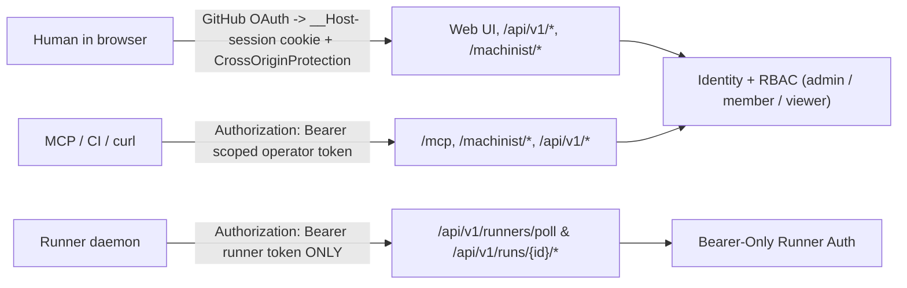

# Spec 1: Identity and Access Control (Focused v1)

*   **Author:** Owain Lewis
*   **Status:** Proposed
*   **Date:** 2026-11-26
*   **Issues:** ENG-216, ENG-178
*   **Parent architecture:** [Production Cloud Run & PostgreSQL](production-cloud-run.md)

--------------------------------------------------------------------------------

## Overview

Machinist is built for engineering teams, not just solo laptops. Before adding PostgreSQL
(Spec 2) or deploying the control plane publicly on Google Cloud Run (Spec 3), Machinist
needs a rock-solid **identity, invite, and role-based access control (RBAC)** layer.

To keep v1 simple, auditable, and fast to ship (preserving Machinist's minimal dependency
footprint — `go.mod` currently has 3 direct dependencies), this specification focuses on:

1. **Single-tenant per deployment:** One Machinist instance serves one team / trust domain
   (matching [SECURITY.md](../../SECURITY.md)). No speculative `workspaces` or `workspace_id`
   columns in v1.
2. **GitHub OAuth for human login (stdlib `net/http`):** Every Machinist team already uses
   GitHub for repositories and pull requests. No local password database to build or defend.
   Generic OIDC (Google Workspace / Okta / Entra ID) is deferred cleanly to **Spec 1b**.
3. **Database-managed invites & Settings → Team:** Bootstrap one initial `admin` via config
   or CLI, then invite teammates, change roles, and offboard users directly in **Settings →
   Team** — with zero container rebuilds or `config.yaml` edits on Cloud Run.
4. **Three-role RBAC (`admin`, `member`, `viewer`):** Mapped 1-to-1 onto Machinist's existing
   `AllowsScope` (`ScopeAll`, `ScopeRun`, `ScopeRead`) permission checks.
5. **Three isolated auth planes:** Browser sessions (humans), bearer-only runner tokens
   (machines), and existing scoped operator/service-account bearer tokens (MCP, CI, `curl`).
6. **Public-instance security hardening:** Server-side `oauth_transactions`, opaque hashed
   `sessions`, proxy-aware `__Host-` cookies, Go stdlib `net/http.CrossOriginProtection` CSRF
   checks, extended `securityHeaders`, bounded rate limiting, and `log/slog` structured JSON
   audit logs to stdout.

--------------------------------------------------------------------------------

## Design Goals & Non-Goals

### Goals

*   **Zero-friction quickstart preserved.** When `auth.github` is not configured, Machinist
    runs identically to today (`machinist init && machinist start && machinist token create`)
    on loopback/private installs.
*   **Safe on the public internet.** Public deployments fail closed at startup if GitHub
    OAuth is unconfigured, reject uninvited GitHub accounts, isolate runner/MCP/browser auth
    planes, and bind returning users to immutable numeric `github_id` (never mutable handles).
*   **Team management without redeploys.** On Cloud Run with immutable baked `config.yaml`
    and `factory/` images, inviting or offboarding teammates happens immediately in the DB.
*   **Three clean vertical slices.** Each slice ships, tests, and merges independently on
    SQLite today and carries cleanly into PostgreSQL (Spec 2).

### Non-Goals (Deferred)

*   **Generic OIDC (Google Workspace / Okta / Entra ID) & cross-provider account linking:**
    Deferred to **Spec 1b** (will reuse the same `users`, `invites`, `sessions`, and
    `oauth_transactions` tables cleanly).
*   **Per-user personal API tokens:** Existing scoped operator/service-account tokens
    (`read`, `run`, full) managed by admins in **Settings → Tokens** cover bots, MCP, and CI
    in v1 without rewriting token uniqueness or adding a second token UI.
*   **In-database `audit_events` table & Audit UI:** Structured JSON audit logs emitted via
    `log/slog` to stdout feed Cloud Logging and `journalctl` directly with zero DB bloat.
*   **Multi-tenant SaaS (`workspaces` / `workspace_id`):** Single-tenant per deployment in v1.
*   **Linear user-ID attribution on Dashboard (`linear_user_id`):** Deferred to Spec 1b.
*   **Email/password authentication & per-repository RBAC.**

--------------------------------------------------------------------------------

## Architecture: Three Isolated Auth Planes

Human browser sessions, runner daemons, and automated API/MCP clients use separate auth
paths:



| Plane | Credential | Accepted on | Rejected on |
| --- | --- | --- | --- |
| **1. Human UI** | Opaque random session token in `__Host-machinist_session` (HTTPS) or `machinist_session` (HTTP) cookie | Browser UI, `/api/v1/*`, `/machinist/*` | `/api/v1/runners/poll`, `/api/v1/runs/{id}/{heartbeat,events,complete,github-token}`, `/mcp` |
| **2. Runners** | `Authorization: Bearer <runner-token>` (`role = 'runner'`, **cookies ignored**) | `POST /api/v1/runners/poll`, `POST /api/v1/runs/{id}/{heartbeat,events,complete,github-token}` | All UI, Settings, Run API, and MCP routes |
| **3. Bots / CLI / MCP** | `Authorization: Bearer <operator-token>` (`role = 'operator'`, scope `""` / `"run"` / `"read"`, **cookies ignored on `/mcp`**) | `/mcp`, `/machinist/*`, `/api/v1/*` within token scope | Runner protocol routes; browser sign-in (`POST /api/v1/session`) when `disable_token_signin` is true; human-session-only `/api/v1/me/*` routes |

**Legacy `RoleAll` (`role == ""`) tokens:** Existing `internal/tickets/store.go:1706` allows
pre-role tokens (`role == ""`) on both operator and runner routes. In v1:
*   When `auth.github` is enabled (or `server.public_url` is non-loopback), `RoleAll` tokens
    are **rejected** on all routes (`403`), and control-plane startup logs a warning if any
    active `RoleAll` token exists, instructing the operator to replace it with a typed
    `--runner` or operator token.

---

## 1. Data Model (SQLite Now, PostgreSQL-Ready for Spec 2)

All timestamps use canonical fixed-width UTC RFC3339Nano strings (`stamp()` in
`internal/tickets/store.go`) on SQLite (`TEXT`) and `TIMESTAMPTZ` (or canonical UTC `TEXT` —
decided uniformly in Spec 2) on PostgreSQL. Every secret (`token_hash`, `id_hash`) is stored
strictly as hex SHA-256 of 32 random bytes from `crypto/rand`.

Enable `PRAGMA foreign_keys = ON;` in `tickets.Open` (`internal/tickets/store.go:64`) so all
`REFERENCES` constraints are enforced on SQLite as well as PostgreSQL.

### New Tables

#### `auth_state` (Singleton concurrency & one-time bootstrap guard)
```sql
CREATE TABLE IF NOT EXISTS auth_state (
    id              INTEGER PRIMARY KEY CHECK (id = 1),
    bootstrapped_at TEXT
);
INSERT OR IGNORE INTO auth_state (id, bootstrapped_at) VALUES (1, NULL);
```
*   Provides a single row to lock (`SELECT id FROM auth_state WHERE id = 1 FOR UPDATE` on
    PostgreSQL; `BEGIN IMMEDIATE` on SQLite) around every admin role change, user disable,
    and initial bootstrap. This prevents PostgreSQL `READ COMMITTED` races where two
    concurrent admins demote/disable each other down to zero admins.
*   `bootstrapped_at` guarantees `auth.bootstrap_admin` can succeed **at most once ever**,
    never re-arming later even if left in `config.yaml`.

#### `users`
```sql
CREATE TABLE IF NOT EXISTS users (
    id            TEXT PRIMARY KEY,        -- 'usr_<16 random hex bytes>'
    role          TEXT NOT NULL CHECK (role IN ('admin', 'member', 'viewer')),
    github_id     TEXT UNIQUE CHECK (github_id IS NULL OR github_id != ''),
    github_login  TEXT NOT NULL DEFAULT '',
    email         TEXT NOT NULL DEFAULT '',
    name          TEXT NOT NULL DEFAULT '',
    avatar_url    TEXT NOT NULL DEFAULT '',
    invited_by    TEXT NOT NULL DEFAULT '', -- user_id, 'bootstrap', or 'cli'
    disabled_at   TEXT,                     -- non-null = offboarded, cannot sign in
    created_at    TEXT NOT NULL,
    updated_at    TEXT NOT NULL
);
```
*   **Immutable identity invariant:** Returning GitHub users match **strictly** on numeric
    `github_id` (as string), never mutable `github_login` or `email`. On each login,
    `github_login`, `email`, `name`, and `avatar_url` (validated as `https://` and ≤ 512
    bytes, else empty) are refreshed.
*   **Last-admin invariant:** Any role downgrade (`admin` → `member`/`viewer`) or user
    disable **must** lock `auth_state` and fail with `409 Conflict` if fewer than 2 active
    (`disabled_at IS NULL`) `admin` users exist.

#### `invites`
```sql
CREATE TABLE IF NOT EXISTS invites (
    id            TEXT PRIMARY KEY,         -- 'inv_<16 random hex bytes>'
    role          TEXT NOT NULL CHECK (role IN ('admin', 'member', 'viewer')),
    github_login  TEXT NOT NULL DEFAULT '', -- lowercase GitHub handle
    email         TEXT NOT NULL DEFAULT '', -- lowercase email address
    token_hash    TEXT NOT NULL UNIQUE,     -- SHA-256 of one-time invite secret
    created_by    TEXT NOT NULL,            -- admin user_id or 'cli'
    expires_at    TEXT NOT NULL,            -- created_at + 7 days
    accepted_by   TEXT REFERENCES users(id),
    accepted_at   TEXT,
    revoked_at    TEXT,
    created_at    TEXT NOT NULL,
    CHECK (github_login != '' OR email != '')
);
CREATE INDEX IF NOT EXISTS idx_invites_github_login ON invites(github_login) WHERE accepted_at IS NULL AND revoked_at IS NULL;
CREATE INDEX IF NOT EXISTS idx_invites_email ON invites(email) WHERE accepted_at IS NULL AND revoked_at IS NULL;
```
*   **Always targeted (no open bearer links):** The `CHECK (github_login != '' OR email != '')`
    constraint forbids untargeted invites. An invite targets **either** `github_login` **or**
    `email` (enforced by API validation: specify exactly one, so matching semantics are never
    ambiguous).
*   **One active invite per target:** Creating a new invite for a target (`github_login` or
    `email`) that already has a pending invite atomically revokes the older pending invite
    first, ensuring deterministic matching when a user signs in directly.
*   **Zero SMTP needed & zero secret leakage in logs:**
    1. Admin enters a teammate's GitHub handle or email + role in **Settings → Team** (or via
       `machinist invite create`).
    2. Machinist returns the one-time invite URL **once** at creation using a **URL fragment**:
       `https://machinist.example.com/#/invite#<secret>`. Because browsers never transmit URL
       fragments to servers, the invite secret **never** appears in Cloud Run access logs or
       HTTP proxy logs.
    3. The teammate can either open that link (the SPA reads `#<secret>`, `POST`s it to
       `POST /api/v1/invites/prepare`, and initiates GitHub OAuth) **or** simply visit
       Machinist and click **Continue with GitHub** (which matches their pending targeted
       invite automatically).
    4. Because only `token_hash` is stored, the **Pending invites** table shows **Regenerate
       link** (rotates `token_hash`, resets 7-day expiry, displays the new link once) and
       **Revoke** — never a "Copy link" button for an already-hashed secret.

#### `sessions`
```sql
CREATE TABLE IF NOT EXISTS sessions (
    id               TEXT PRIMARY KEY,      -- 'ses_<16 random hex bytes>'
    token_hash       TEXT NOT NULL UNIQUE,  -- SHA-256 of cookie secret ('mses_<64 hex>')
    auth_method      TEXT NOT NULL CHECK (auth_method IN ('github', 'token')),
    user_id          TEXT REFERENCES users(id),
    token_id         TEXT REFERENCES tokens(id),
    user_agent       TEXT NOT NULL DEFAULT '',
    ip_address       TEXT NOT NULL DEFAULT '',
    created_at       TEXT NOT NULL,
    last_seen_at     TEXT NOT NULL,
    idle_expires_at  TEXT NOT NULL,         -- sliding: now + 7 days
    expires_at       TEXT NOT NULL,         -- absolute cap: created_at + 30 days
    revoked_at       TEXT,
    CHECK (
        (auth_method = 'github' AND user_id IS NOT NULL AND token_id IS NULL) OR
        (auth_method = 'token'  AND token_id IS NOT NULL AND user_id IS NULL)
    )
);
CREATE INDEX IF NOT EXISTS idx_sessions_user ON sessions(user_id, revoked_at);
CREATE INDEX IF NOT EXISTS idx_sessions_token ON sessions(token_id, revoked_at);
```
*   **Unified session model (OAuth + Quickstart):** Every browser sign-in — whether GitHub
    OAuth (`auth_method = 'github'`) or quickstart token paste (`auth_method = 'token'`) —
    creates a row in `sessions` and puts only the opaque random session secret (`mses_...`)
    in the cookie, never a raw API bearer token.
*   **Instant revocation cascade:**
    *   `DELETE /api/v1/session` revokes the current session row immediately.
    *   Disabling a user revokes **all** of their active `sessions` AND revokes all pending
        `invites` matching their `github_login` or `email` in the same transaction.
    *   `RevokeToken` and `RegenerateToken` (`internal/tickets/store.go`) revoke all
        `sessions` with `token_id = <revoked_token_id>` in the same transaction.
    *   `internal/controlplane/settings_http.go:307–311, 349–354` is decoupled from
        `sessionCookie` (except when the active cookie is specifically a `token`-backed
        quickstart session for that exact `token_id`, so regenerating/revoking a workspace
        token never clobbers an admin's GitHub OAuth cookie!).
*   **Throttled activity updates:** `last_seen_at` and `idle_expires_at` update at most once
    per minute (`tokenUseInterval` in `internal/tickets/store.go:1899`) using Postgres-safe
    `(last_seen_at < ?)` comparisons. Expired/revoked rows older than 30 days are pruned
    periodically.

#### `oauth_transactions`
```sql
CREATE TABLE IF NOT EXISTS oauth_transactions (
    id_hash        TEXT PRIMARY KEY,        -- SHA-256 of cookie secret ('moauth_<64 hex>')
    provider       TEXT NOT NULL CHECK (provider IN ('github')),
    state          TEXT NOT NULL,
    pkce_verifier  TEXT NOT NULL,
    return_to      TEXT NOT NULL DEFAULT '/',
    invite_id      TEXT REFERENCES invites(id),
    expires_at     TEXT NOT NULL,           -- created_at + 10 minutes
    created_at     TEXT NOT NULL
);
```
*   Replaces any stateless cookie signing key (`SESSION_SECRET` is **not** needed).
*   Survives Cloud Run rolling deploys cleanly across overlapping revisions.
*   Consumed atomically on callback via `DELETE FROM oauth_transactions WHERE id_hash = ?
    AND expires_at > ? RETURNING ...` (or transactional `SELECT` + `DELETE` on SQLite),
    preventing callback replay.

---

## 2. Role-Based Access Control (RBAC) Matrix

Roles map directly onto Machinist's existing `tickets.AllowsScope`:
*   `viewer` → `ScopeRead`
*   `member` → `ScopeRun` (includes `ScopeRead`)
*   `admin` → `ScopeAll` (`""`, includes `ScopeRun` and `ScopeRead`)

In `internal/controlplane/auth.go`, refactor `authenticatedHandler` to pass a `Principal`
struct (`Kind: "user" | "token"`, `UserID`, `Name`, `Role: "admin" | "member" | "viewer"`,
`SessionID`, `ViaCookie bool`).

| Route | Unauth | `viewer` | `member` | `admin` | `runner` (Bearer only) |
| --- | --- | --- | --- | --- | --- |
| `GET /healthz`, `GET /api/v1/auth/status`, `GET /auth/github/{start,callback}`, `POST /api/v1/invites/prepare`, static shell `/` | `200`/`302` | `200`/`302` | `200`/`302` | `200`/`302` | `200`/`302` (public) |
| `POST /api/v1/session` (quickstart token sign-in) | `200` (if enabled) / `403` (if disabled) | Same | Same | Same | `403` |
| `GET /api/v1/me`, `DELETE /api/v1/session` | `401` | `200`/`204` | `200`/`204` | `200`/`204` | `403` |
| `GET /api/v1/me/sessions`, `DELETE /api/v1/me/sessions/{id}` *(browser session only)* | `401` | `200`/`204` | `200`/`204` | `200`/`204` | `401`/`403` |
| `GET /api/v1/tickets`, `GET /api/v1/tickets/{id}`, `GET /api/v1/runs/{id}/{events,patch}` | `401` | `200` | `200` | `200` | `403` |
| `GET /api/v1/{ledger,usage,stats,runners,repositories,presets,agents,automations}` | `401` | `200` | `200` | `200` | `403` |
| `GET /machinist/jobs`, `GET /machinist/jobs/{id}` | `401` | `200` | `200` | `200` | `403` |
| `POST /api/v1/tickets`, `POST /api/v1/tickets/{id}/{cancel,rerun}` | `401` | `403` | `200`/`201` | `200`/`201` | `403` |
| `POST /machinist/run`, `POST /machinist/jobs/{id}/{cancel,rerun}` | `401` | `403` | `200`/`201` | `200`/`201` | `403` |
| `POST /api/v1/automations/{name}/run` | `401` | `403` | `200`/`201` | `200`/`201` | `403` |
| `POST /mcp` *(Bearer only — cookies ignored → `401`)* | `401` | Read tools ok; write tools return HTTP `200` + JSON-RPC `isError: true` | Read & run tools ok | Read & run tools ok | `403` |
| `GET /api/v1/setup`, `GET /api/v1/settings/{github,linear}` | `401` | `403` | `403` | `200` | `403` |
| `POST /api/v1/projects`, `DELETE /api/v1/projects/{owner}/{name}` | `401` | `403` | `403` | `200`/`204` | `403` |
| `DELETE /api/v1/runners/{name}` | `401` | `403` | `403` | `204` | `403` |
| `GET/POST/DELETE /api/v1/tokens`, `POST /api/v1/tokens/{name}/regenerate` | `401` | `403` | `403` | `200`/`201`/`204` | `403` |
| `GET /api/v1/team/members`, `PATCH /api/v1/team/members/{id}` | `401` | `403` | `403` | `200` | `403` |
| `GET/POST /api/v1/team/invites`, `DELETE /api/v1/team/invites/{id}`, `POST /api/v1/team/invites/{id}/regenerate` | `401` | `403` | `403` | `200`/`201`/`204` | `403` |
| `POST /api/v1/reload` | `401` | `403` | `403` | `200` | `403` |
| `POST /api/v1/runners/poll`, `POST /api/v1/runs/{id}/{heartbeat,events,complete,github-token}` *(Bearer only)* | `401` | `401` (cookie) / `403` (bearer) | `401` (cookie) / `403` (bearer) | `401` (cookie) / `403` (bearer) | `200`/`204` |

Notes:
*   `DELETE /api/v1/session` (`internal/controlplane/server.go:402`) is loosened from
    `requireToken` (`admin`) to any authenticated human role (`viewer`+).
*   Workspace operator tokens (`role = 'operator'`) keep mapping directly: `ScopeRead` →
    `viewer`, `ScopeRun` → `member`, `ScopeAll` (`""`, displayed as `"full"`) → `admin` (so
    `machinist reload`, which mints a temporary operator token in `internal/cli/reload.go:200`,
    keeps working seamlessly).
*   Role changes take effect **immediately** on active browser sessions because the session
    lookup joins `users.role` and `users.disabled_at` on every request.

---

## 3. Concrete HTTP API Contracts

All JSON error responses follow Machinist's existing `{"error": "..."}` envelope.

### `GET /api/v1/auth/status` *(unauthenticated)*
```json
{
  "authenticated": false,
  "methods": ["github"],
  "token_signin_enabled": false
}
```
When `authenticated: false`, leaks no user handles, repo names, or setup details.

### `GET /api/v1/me` *(any authenticated caller)*
*   For a GitHub OAuth session (`auth_method = "github"`):
```json
{
  "auth_method": "github",
  "role": "admin",
  "version": "v0.6.0",
  "user": {
    "id": "usr_...",
    "github_login": "owainlewis",
    "name": "Owain Lewis",
    "email": "owain@example.com",
    "avatar_url": "https://avatars.githubusercontent.com/u/..."
  }
}
```
*   For a quickstart/workspace bearer token (no `users` row):
```json
{
  "auth_method": "token",
  "role": "admin",
  "version": "v0.6.0",
  "token_name": "owain"
}
```

### `GET /api/v1/me/sessions` & `DELETE /api/v1/me/sessions/{id}` *(browser session only)*
*   `GET` returns `{"sessions": [{"id", "auth_method", "user_agent", "ip_address", "created_at", "last_seen_at", "current": true}]}` scoped strictly to the caller's `user_id` (or `token_id` in quickstart mode).
*   `DELETE` revokes the specified session if owned by the caller (`204`, else `404`).

### `POST /api/v1/invites/prepare` *(unauthenticated, rate-limited, same-origin)*
*   Request: `{"token": "<raw invite secret from URL fragment>"}`
*   Validates `SHA-256(token)` against `invites` (`accepted_at IS NULL AND revoked_at IS NULL AND expires_at > now`).
*   Returns `200`: `{"valid": true, "role": "member", "target_hint": "github:alice", "start_url": "/auth/github/start?invite_tx=..."}` (or stores `invite_id` in a fresh `oauth_transactions` row + sets `__Host-machinist_oauth` cookie and returns `{"valid": true, "role": "member", "start_url": "/auth/github/start"}`).
*   Invalid / expired / revoked invite returns `404 {"error": "This invite link is invalid or has expired."}` (never distinguishing unknown vs. revoked vs. accepted).

### `GET /api/v1/team/members` & `PATCH /api/v1/team/members/{id}` *(admin)*
*   `GET` returns `{"members": [{"id", "role", "github_login", "name", "email", "avatar_url", "disabled_at", "last_seen_at", "created_at"}]}` (ordered active first, then `created_at`).
*   `PATCH /api/v1/team/members/{id}` request (at least one field required):
    ```json
    {"role": "member", "disabled": false}
    ```
    *   Changing `role` to `"admin" | "member" | "viewer"` or setting `disabled: true` runs
        inside a transaction locking `auth_state`.
    *   Returns `409 Conflict` if the change would leave 0 active admins.
    *   Setting `disabled: true` revokes all active `sessions` for `{id}` and all pending
        `invites` matching their `github_login` or `email`. Setting `disabled: false`
        re-enables the user (they must sign in again via GitHub OAuth).
    *   Returns `200` with the updated member object.

### `GET/POST /api/v1/team/invites`, `DELETE /api/v1/team/invites/{id}`, `POST /api/v1/team/invites/{id}/regenerate` *(admin)*
*   `GET /api/v1/team/invites` returns `{"invites": [{"id", "role", "github_login", "email", "created_by", "expires_at", "created_at"}]}` (pending unexpired invites only; never returns any token/hash).
*   `POST /api/v1/team/invites` request (exactly one of `github_login` or `email` required):
    ```json
    {"role": "member", "github_login": "alice"}
    ```
    *   Revokes any existing pending invite for the same target, creates the new invite, and
        returns `201`:
        ```json
        {"invite": {"id": "inv_...", "role": "member", "github_login": "alice", "expires_at": "..."}, "invite_url": "https://machinist.example.com/#/invite#<secret>"}
        ```
        (`invite_url` is shown once; when `server.public_url` is unset, returns relative path `/#/invite#<secret>`.)
*   `POST /api/v1/team/invites/{id}/regenerate` rotates `token_hash` and extends `expires_at` by 7 days, returning `200` with the new one-time `invite_url`.
*   `DELETE /api/v1/team/invites/{id}` sets `revoked_at = now` and returns `204`.

---

## 4. Configuration, Bootstrap & GitHub OAuth Flow

### Configuration (`config.yaml`)

Following `internal/config/config.go`'s existing `Linear` convention (`LINEAR_CLIENT_ID`,
`LINEAR_CLIENT_SECRET`), OAuth secrets use fixed environment variable names with **no**
`*_env` YAML indirection keys:

```yaml
server:
  public_url: https://machinist.example.com
  trusted_proxy_hops: 1              # 0 (default) = r.RemoteAddr; 1 = Cloud Run; 2 = Cloud LB + Cloud Run

auth:
  # Default: true when auth.github.enabled is true; false in quickstart mode.
  disable_token_signin: true
  # Required explicit opt-in ONLY if running token-only auth on a non-loopback public_url.
  allow_token_only_public: false
  # Optional one-time initial admin (also MACHINIST_BOOTSTRAP_ADMIN; env overrides YAML).
  # Format: "github:<login>" (case-insensitive). Inert forever once auth_state.bootstrapped_at is set.
  bootstrap_admin: github:owainlewis

  github:
    enabled: true                    # reads GITHUB_OAUTH_CLIENT_ID & GITHUB_OAUTH_CLIENT_SECRET from env
```

### Startup & Reload Rules

*   **Env check placement:** Matching `Linear.CheckCredentials()` (`internal/config/config.go:330`),
    verifying `GITHUB_OAUTH_CLIENT_ID` and `GITHUB_OAUTH_CLIENT_SECRET` happens in
    `controlplane.New` — **never** in `config.LoadConfig` — so local CLI commands
    (`machinist token create`, `machinist invite create`) work without OAuth secrets exported.
*   **Fail-closed public check:** Reuse `internal/controlplane/host.go`'s `isLoopbackHost`.
    If `server.public_url` has a non-loopback host and `auth.github.enabled` is false,
    `controlplane.New` refuses to start unless `auth.allow_token_only_public: true`.
*   **Callback URL requirement:** When `auth.github.enabled` is true, `server.public_url` is
    required so the exact redirect URI `${public_url}/auth/github/callback` is never derived
    from a spoofable `Host` header.
*   **Restart-only in `reload.go`:** Add `server.public_url`, `server.trusted_proxy_hops`,
    and `auth.*` to `restartSettingsDiff` (`internal/controlplane/reload.go:82–88`) so
    `machinist reload` can never weaken public auth or flip cookie names mid-flight.

### GitHub OAuth Flow (Stdlib `net/http` + PKCE)

1. Browser navigates to `GET /auth/github/start?return_to=%2F%23%2Fjobs%2Ft_123` (via link
   or `window.location.assign`, never a `<form>` POST redirect).
2. Server validates `return_to` (must start with `/` and NOT `//`, and contain no `\`),
   generates 32-byte random `state`, PKCE `code_verifier` (`S256`), and opaque cookie token
   `moauth_<64 hex>`, inserts an `oauth_transactions` row (preserving any `invite_id` from
   `POST /api/v1/invites/prepare`), sets `__Host-machinist_oauth` (HTTPS) or
   `machinist_oauth` (HTTP) (`HttpOnly; SameSite=Lax; MaxAge=600`), and redirects to
   `https://github.com/login/oauth/authorize` with minimal scope `read:user user:email`
   (**never** `repo`).
3. On `GET /auth/github/callback`:
   *   Atomically consume the `oauth_transactions` row by `SHA-256(cookie)` (`expires_at > now`)
       and clear the transaction cookie. Verify `state` in constant time (`subtle.ConstantTimeCompare`).
   *   Exchange `code` + PKCE `code_verifier` at `https://github.com/login/oauth/access_token`.
   *   Call `GET https://api.github.com/user` (read immutable numeric `id`, `login`, `name`,
       `avatar_url`; **ignore** `.email` because it may be unverified) and
       `GET https://api.github.com/user/emails` (collect lowercase emails where `verified == true`,
       preferring `primary && verified` as the display email).
   *   **Discard the GitHub access token immediately** — never store or log it.
   *   In one transaction (locking `auth_state` if provisioning/bootstrapping):
       1. Look up existing `users` by `github_id`:
          *   If found and `disabled_at IS NOT NULL`: emit `auth.login.denied` audit JSON and
              redirect to `/#/sign-in?error=disabled`.
          *   If found and enabled: refresh profile fields (`github_login`, `email`, `name`,
              `avatar_url`), mint `sessions` row, emit `auth.login.succeeded`, redirect to
              `return_to`. (If the user opened an invite link while already an active member,
              do not overwrite their role or consume the invite — simply sign them in.)
       2. Otherwise, check one-time bootstrap: if `auth_state.bootstrapped_at IS NULL` and
          `bootstrap_admin` equals `"github:" + strings.ToLower(login)`: set
          `auth_state.bootstrapped_at = now`, insert `users` with `role = 'admin'`, emit
          `member.bootstrapped` + `auth.login.succeeded`, mint `sessions` row.
       3. Otherwise, check pending unexpired invites:
          *   If `oauth_transactions.invite_id` is set: verify that specific invite is still
              pending/unexpired AND matches `strings.ToLower(login)` (if `github_login != ''`)
              OR any verified email from `/user/emails` (if `email != ''`).
          *   Else: find a pending unexpired invite matching `github_login = lower(login)`
              or `email IN (verified_emails)` (newest wins if somehow multiple targets match
              the same person).
          *   If matched: insert `users` with `invite.role`, mark `invites.accepted_by` +
              `accepted_at`, emit `invite.accepted` + `auth.login.succeeded`, mint `sessions`
              row.
       4. Otherwise: emit `auth.login.denied` (with `github_login`, no user created) and
          redirect to `/#/sign-in?error=not_invited`.

---

## 5. Public-Instance Security Hardening

1. **Proxy-aware `Secure` & `__Host-` session cookies:**
   *   Compute `isHTTPS = strings.HasPrefix(cfg.Server.PublicURL, "https://") ||
       cfg.Server.TLSCert != "" || (r != nil && r.TLS != nil)`.
   *   When `isHTTPS`: cookie name `__Host-machinist_session`, `Secure: true`, `HttpOnly: true`,
       `Path: "/"`, `Domain: ""`, `SameSite: Lax`. Plain-HTTP local dev uses `machinist_session`.
   *   When `server.public_url` is set, redirect/reject mismatched `Host` headers on browser
       routes (exempting `GET /healthz`) so Cloud Run's `*.run.app` alias cannot break
       `__Host-` OAuth cookies. Also allow `server.public_url`'s host inside `loopbackHostOnly`
       (`internal/controlplane/server.go:443`) so local Caddy/nginx reverse proxies work.
2. **CSRF protection using Go stdlib `net/http.CrossOriginProtection`:**
   *   Machinist targets Go 1.26.6 (`go.mod:3`), which includes `net/http.NewCrossOriginProtection()`.
   *   Enforce it on all cookie-authenticated non-safe requests (`POST`/`PUT`/`PATCH`/`DELETE`),
       on `POST /api/v1/session` (prevents Login CSRF), and on `POST /api/v1/invites/prepare`.
   *   Bypass only requests authenticated strictly via `Authorization: Bearer` (with no cookie
       fallback), enforce `Content-Type: application/json` on JSON mutation handlers, and
       reject `Origin: null`.
3. **Strict bearer-only machine endpoints:**
   *   Change `requireRunner` (`internal/controlplane/auth.go:79`) from `requestToken(r)` to
       `bearerToken(r)` (matching `handleMCP`).
4. **Extend existing `securityHeaders` (`internal/controlplane/server.go:457–464`):**
   *   Keep existing `base-uri 'none'`, `font-src 'self'`, `img-src 'self' blob:`,
       `Referrer-Policy: no-referrer`, and `X-Content-Type-Options: nosniff`.
   *   Add `https://avatars.githubusercontent.com` to `img-src` (no wildcard `https:`), add
       `X-Frame-Options: DENY`, and add `Strict-Transport-Security: max-age=31536000;
       includeSubDomains` when `isHTTPS`. Do **not** add `form-action 'self'` (breaks OAuth
       redirects in Chrome/Safari if ever triggered via form).
5. **Bounded per-IP rate limiting:**
   *   Extract client IP using `server.trusted_proxy_hops` (default `0` → `r.RemoteAddr`,
       preventing `X-Forwarded-For` spoofing on direct VMs).
   *   Bounded LRU/TTL in-memory token bucket (e.g., max 10,000 tracked IPs) on `/auth/*`,
       `/api/v1/invites/prepare`, and `POST /api/v1/session` (20 req/min per IP, burst 10).
   *   Do **not** block valid authenticated bearer traffic sharing a NAT IP when an invalid
       token hits `401`; log `401` bursts to stdout only.
6. **Structured JSON audit logs (`log/slog`):**
   *   Emit single-line JSON audit records (`{"audit":true,"action":"...","actor_id":"...","actor_name":"...","target":"...","outcome":"...","ip":"..."}`)
       for login succeeded/denied, bootstrap, invite created/regenerated/revoked/accepted,
       member role changed/disabled/re-enabled, token created/regenerated/revoked, and
       job started/cancelled/rerun.
7. **`GET /healthz` compatibility:**
   *   When `server.public_url` is non-loopback, return `{"ok":true}` (omitting version); on
       loopback/private installs keep `{"version": s.version}` (or update
       `TestHealthzIsOpenAndReturnsVersion` in `server_test.go:111–117` explicitly).

---

## 6. Web UI & CLI Experience

### Frontend Boot & Role-Aware Routing
*   Replace `GET /api/v1/repositories` probe in `internal/controlplane/web/src/main.jsx:67`
    with `GET /api/v1/auth/status` followed by `GET /api/v1/me` when authenticated.
*   Gate `GET /api/v1/setup` (`main.jsx:101`) and the Settings nav dot on `me.role === "admin"`.
*   Update `routes.js:20` so `#/settings` defaults to `overview` for `admin` and `account` for
    `member`/`viewer`; redirect `viewer` away from `#/new` (`jobs-page.jsx:286`).
*   Hide write/admin controls by role:
    *   `viewer`: hide **New job**, **Start one**, **Run**, **Run again**, **Cancel**, and
        **Remove** runner (`runners.jsx:141`).
    *   `member`: hide **Remove** runner (`runners.jsx:141`) and admin Settings tabs
        (`Overview`, `Projects`, `GitHub`, `Linear`, `Tokens`, `Team`).
    *   `admin`: full UI including **Settings → Team** (`#/settings/team`) and **Settings →
        My Account** (`#/settings/account`).

### Settings → Team (`admin`) & Settings → My Account (all signed-in users)
*   **My Account (`#/settings/account`):** Profile summary (avatar, GitHub handle, role badge)
    and active browser sessions list with per-session **Revoke**.
*   **Team (`#/settings/team`):**
    *   **Members table:** Avatar, name, GitHub handle, role dropdown (`admin`/`member`/`viewer`,
        disabled on the sole active admin), status (`Active`/`Disabled`), last seen, and
        **Disable** / **Re-enable** button.
    *   **Invite member:** Target type (`GitHub username` or `Email`) + value + role →
        displays the one-time fragment invite URL (`/#/invite#<secret>`) once in a copyable
        banner.
    *   **Pending invites table:** Target, role, expiry, **Regenerate link**, and **Revoke**.

### CLI Additions
*   `machinist invite create --role <admin|member|viewer> (--github <login> | --email <addr>)`
    (prints one-time `/#/invite#<secret>` URL using `server.public_url` if set, else relative path)
*   `machinist invite list` / `machinist invite revoke <id>`
*   `machinist user list` / `machinist user set-role <id-or-github-login> <role>` / `machinist user disable <id-or-github-login>` / `machinist user enable <id-or-github-login>`

---

## 7. Vertical Implementation Slices (Ready for Linear)

| Slice | Scope | Done when |
| --- | --- | --- |
| **Slice 1: Schema & Public Hardening** | Add `auth_state`, `users`, `invites`, `sessions`, `oauth_transactions` tables; enable SQLite `PRAGMA foreign_keys = ON`; migrate quickstart `POST /api/v1/session` to `sessions` (`auth_method='token'`) with token-revocation cascade & decoupled `settings_http.go`; fix proxy-aware `__Host-` cookies; add `net/http.CrossOriginProtection`, bearer-only `requireRunner`, `RoleAll` public rejection, extended `securityHeaders`, `server.trusted_proxy_hops` + bounded rate limiter, and `reload.go` restart-only rules. | Existing quickstart flow & tests pass; new tests prove `__Host-` cookie behind proxy, CSRF `403`, bearer-only runners (`401` on cookie), `RoleAll` rejection, token revocation cascading to browser sessions, and rate limits. |
| **Slice 2: GitHub OAuth, Bootstrap & Invites** | Implement `auth.github`, `auth.bootstrap_admin`, fail-closed non-loopback startup check, `/auth/github/{start,callback}` (stdlib `net/http` + PKCE + `oauth_transactions`), `POST /api/v1/invites/prepare`, `GET /api/v1/auth/status`, `GET /api/v1/me`, `GET/DELETE /api/v1/me/sessions`, CLI `machinist invite`, and Sign-in + `/#/invite#<secret>` UI. | First admin bootstraps once (`auth_state.bootstrapped_at`); invited user redeems targeted or fragment invite; disabled user is blocked; uninvited user gets `not_invited` + `slog` audit JSON; handle rename cannot hijack `github_id`. |
| **Slice 3: 3-Role RBAC & Settings → Team** | Enforce `admin`/`member`/`viewer` across every route in `server.go` (using `Principal` + `AllowsScope`), build `/api/v1/team/{members,invites}` endpoints with `auth_state`-locked last-admin guard & offboarding cascade, build **Settings → Team** & **Settings → My Account** UI, role-gate frontend actions (`main.jsx`, `routes.js`, `runners.jsx`, `jobs-page.jsx`), add CLI `machinist user`, and wire `log/slog` JSON audit events. | Full RBAC matrix test suite passes across `viewer`, `member`, `admin`, `runner`, and scoped workspace tokens (including `/mcp` JSON-RPC `isError: true`); disabling a user kills all active sessions + pending invites; last admin cannot be demoted or disabled. |

---

## Security Verification Checklist

- [ ] Every `/api/v1/*`, `/machinist/*`, and `/mcp` route returns `401` when unauthenticated (except `GET /api/v1/auth/status`, `POST /api/v1/invites/prepare`, and `POST /api/v1/session` when enabled).
- [ ] Every route in the RBAC matrix is tested against `viewer`, `member`, `admin`, `runner`, and scoped operator tokens (including `/mcp` JSON-RPC `isError: true` on insufficient scope).
- [ ] Cookie-authenticated mutations, `POST /api/v1/session`, and `POST /api/v1/invites/prepare` reject cross-origin or `Origin: null` requests (`403`).
- [ ] Runner routes ignore browser session cookies (`401`) and reject non-runner bearer tokens (`403`); `RoleAll` tokens are rejected when public auth is enabled.
- [ ] Disabling a user revokes all active browser sessions and pending invites matching their handle/email in one transaction; `RevokeToken`/`RegenerateToken` revokes quickstart `token` sessions without touching OAuth cookies.
- [ ] Concurrent admin demotion/disable transactions cannot reduce active admins below 1 (`409`); `bootstrap_admin` fires at most once (`auth_state.bootstrapped_at`).
- [ ] Re-inviting a previously disabled/re-enabled or un-enrolled user works cleanly; OAuth `state` mismatch, PKCE failure, callback replay, expired/revoked invite, wrong target user on invite link, and open-redirect `return_to` (`//evil.com`) are all rejected.
- [ ] Startup refuses non-loopback `server.public_url` without `auth.github.enabled: true` unless `auth.allow_token_only_public: true`.
- [ ] Zero GitHub access tokens, raw session secrets, raw invite secrets, or raw bearer tokens are ever stored in the database or logged.
