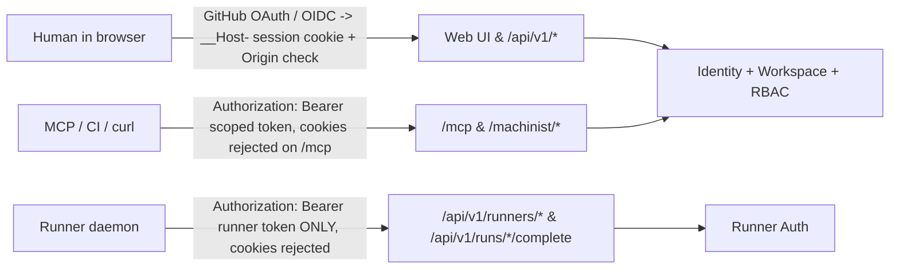

# Spec 1: Identity, Workspaces, and Access Control

*   **Author:** Owain Lewis
*   **Status:** Proposed
*   **Date:** 2026-11-26
*   **Issues:** ENG-216, ENG-178
*   **Parent architecture:** [Production Cloud Run & Auth](production-cloud-run.md)

--------------------------------------------------------------------------------

## Overview

Machinist is built for engineering teams, not just solo laptops. Before adding PostgreSQL
(Spec 2) or deploying the control plane publicly on Google Cloud Run (Spec 3), Machinist
needs a first-class **identity, workspace, and access-control model**.

This specification defines:

1. **Workspaces & tenancy:** Single-tenant per deployment today (1 company = 1 database and
   trust domain), with a `workspaces` table and `workspace_id` on core tables so a hosted
   multi-tenant Machinist Cloud can be added later without a primary-key rewrite.
2. **Federated human login:** **GitHub OAuth** (first) and **Generic OIDC** (second —
   covering Google Workspace, Okta, Microsoft Entra ID, Auth0, and Keycloak). No local
   password database to build, hash, reset, or defend.
3. **Database-managed invites & team administration:** Bootstrap one initial `admin` via
   config/env or CLI, then invite teammates, change roles, and offboard users directly in
   **Settings → Team** — with zero container rebuilds or `config.yaml` edits on Cloud Run.
4. **Three-role RBAC:** `admin`, `member`, and `viewer`, mapped cleanly onto Machinist's
   existing route structure.
5. **Three isolated auth planes:** Browser sessions (humans), bearer-only runner tokens
   (machines), and scoped workspace service-account or personal tokens (MCP, CI, `curl`).
6. **Public-instance security hardening:** Opaque hashed `sessions`, proxy-aware `__Host-`
   cookies, same-origin CSRF enforcement, security headers, rate limiting, and structured
   security audit logs — while keeping `machinist init && machinist start` zero-friction for
   local quickstarts.

--------------------------------------------------------------------------------

## Design Goals & Non-Goals

### Goals

*   **Zero-friction quickstart preserved.** When neither `auth.github` nor `auth.oidc` is
    configured, Machinist runs identically to today with `machinist token create` on
    loopback/private installs.
*   **Safe on the public internet.** Every public-facing deployment enforces federated login,
    explicit invite-based workspace membership, fail-closed startup checks, and defense in
    depth against CSRF, session hijacking, account takeover, and brute force.
*   **Team management without redeploys.** On Cloud Run where `config.yaml` and `factory/`
    are baked into an immutable image, inviting a new hire or offboarding an ex-employee
    happens instantaneously in **Settings → Team** (backed by the database).
*   **Schema ready for PostgreSQL & future SaaS.** Spec 2 (PostgreSQL) implements this exact
    schema once instead of migrating a legacy single-user layout.
*   **Clean vertical slices.** Each slice ships, tests, and merges independently without
    breaking existing installs.

### Non-Goals

*   **Email/password authentication.** Dev teams expect SSO (GitHub or OIDC); passwords add
    credential-stuffing, reset-email, and MFA surface area with little benefit.
*   **SAML 2.0 / SCIM in v1.** OIDC covers modern Google Workspace, Okta, and Entra ID;
    SAML/SCIM can be added later without changing the internal `users` / `memberships` model.
*   **Multi-tenant SaaS routing in v1.** `workspace_id` is stored and enforced in the data
    layer, but each deployment serves one default workspace until multi-workspace routing,
    per-workspace GitHub Apps, and tenant billing are designed separately.
*   **Per-repository RBAC in v1.** Roles apply workspace-wide (`admin`, `member`, `viewer`).

--------------------------------------------------------------------------------

## Architecture: Three Isolated Auth Planes

Human sessions, runner daemons, and automated API/MCP callers must never share an auth
surface:



| Plane | Credential | Accepted on | Rejected on |
| --- | --- | --- | --- |
| **1. Human UI** | Opaque random session token in `__Host-machinist_session` cookie | Browser UI, `/api/v1/*`, `/machinist/*` | `/api/v1/runners/poll`, `/api/v1/runs/{id}/{heartbeat,events,complete,github-token}`, `/mcp` |
| **2. Runners** | `Authorization: Bearer <runner-token>` (`role = runner`) | Runner protocol routes only | All UI, Settings, Run API, and MCP routes |
| **3. Bots / CLI / MCP** | `Authorization: Bearer <token>` (`owner_type = workspace \| user`, scoped `read` / `run` / `admin`) | `/mcp`, `/machinist/*`, `/api/v1/*` within scope & owner's role | Runner protocol routes; browser session sign-in (`POST /api/v1/session`) when `disable_token_signin` is true |

---

## 1. Data Model (SQLite & PostgreSQL Compatible)

Every timestamp is stored as UTC RFC3339 (TEXT in SQLite, `TIMESTAMPTZ` in PostgreSQL).
Every secret (`token_hash`) is stored strictly as a hex-encoded SHA-256 hash of a
32-byte cryptographically random secret (`crypto/rand`).

### New Tables

#### `workspaces`
```sql
CREATE TABLE workspaces (
    id          TEXT PRIMARY KEY,          -- e.g. 'ws_default' or 'ws_<random>'
    slug        TEXT NOT NULL UNIQUE,      -- e.g. 'default' or 'gradientwork'
    name        TEXT NOT NULL,             -- display name, e.g. 'Gradientwork'
    created_at  TEXT NOT NULL
);
```
*   On startup of a fresh or upgraded database, Machinist ensures one default workspace row
    exists (`slug = 'default'`, name from `server.workspace_name` or `"Default"`).
*   All existing rows in core tables are backfilled to this `workspace_id` idempotently.

#### `users`
```sql
CREATE TABLE users (
    id              TEXT PRIMARY KEY,      -- e.g. 'usr_<random>'
    email           TEXT NOT NULL DEFAULT '',
    name            TEXT NOT NULL DEFAULT '',
    avatar_url      TEXT NOT NULL DEFAULT '',
    github_id       TEXT UNIQUE,           -- immutable numeric GitHub user ID (as string)
    github_login    TEXT NOT NULL DEFAULT '',
    oidc_issuer     TEXT,                  -- normalized issuer URL
    oidc_subject    TEXT,                  -- immutable OIDC 'sub' claim
    linear_user_id  TEXT NOT NULL DEFAULT '',
    disabled_at     TEXT,                  -- non-null = offboarded, cannot sign in or use tokens
    created_at      TEXT NOT NULL,
    updated_at      TEXT NOT NULL,
    UNIQUE (oidc_issuer, oidc_subject)
);
```
*   **Critical security invariant:** Never key an existing user account on mutable `github_login`
    or `email`. GitHub handles can be renamed and claimed by another person; emails can be
    reassigned. Always match returning users strictly by immutable **`github_id`** (GitHub
    OAuth) or immutable **`(oidc_issuer, oidc_subject)`** (OIDC), updating `github_login`,
    `email`, `name`, and `avatar_url` on each login.
*   `linear_user_id` optionally links a user to their Linear identity so Dashboard spend and
    activity unify Web UI and Linear-delegated jobs under one person.

#### `memberships`
```sql
CREATE TABLE memberships (
    workspace_id  TEXT NOT NULL REFERENCES workspaces(id),
    user_id       TEXT NOT NULL REFERENCES users(id),
    role          TEXT NOT NULL CHECK (role IN ('admin', 'member', 'viewer')),
    invited_by    TEXT NOT NULL DEFAULT '', -- user_id or 'bootstrap'
    created_at    TEXT NOT NULL,
    updated_at    TEXT NOT NULL,
    PRIMARY KEY (workspace_id, user_id)
);
```
*   **Last-admin invariant:** Any role downgrade (`admin` → `member`/`viewer`), membership
    removal, or user disable **must fail in a transaction** if it would leave the workspace
    with zero active (non-disabled) `admin` members.

#### `invites`
```sql
CREATE TABLE invites (
    id            TEXT PRIMARY KEY,        -- e.g. 'inv_<random>'
    workspace_id  TEXT NOT NULL REFERENCES workspaces(id),
    role          TEXT NOT NULL CHECK (role IN ('admin', 'member', 'viewer')),
    github_login  TEXT NOT NULL DEFAULT '', -- optional lowercase GitHub login target
    email         TEXT NOT NULL DEFAULT '', -- optional lowercase email target
    token_hash    TEXT NOT NULL UNIQUE,    -- SHA-256 of one-time invite link secret
    created_by    TEXT NOT NULL,           -- admin user_id or 'cli'
    expires_at    TEXT NOT NULL,           -- default: created_at + 7 days
    accepted_by   TEXT,                    -- user_id that redeemed it
    accepted_at   TEXT,
    revoked_at    TEXT,
    created_at    TEXT NOT NULL
);
```
*   Invites require **no SMTP server** and work smoothly in two ways:
    1. **Targeted invite (recommended):** An admin enters a teammate's GitHub handle (e.g.
       `alice`) or corporate email (`alice@company.com`) and picks a role (`admin`,
       `member`, `viewer`). Machinist stores the invite AND returns a one-time invite URL.
       The teammate can either click the invite URL **or** simply visit Machinist and click
       **Sign in with GitHub / SSO** — Machinist matches the active, unexpired targeted
       invite, binds their immutable `github_id` or `(oidc_issuer, oidc_subject)`, creates
       their membership, and marks the invite accepted atomically.
    2. **Pinned invite link:** Visiting `/invite/<secret>` stores the invite token in the
       OAuth transaction cookie and starts OAuth/OIDC. If the invite specifies `github_login`
       or `email`, redemption succeeds **only** if the authenticated identity matches it
       (preventing a leaked Slack link from being redeemed by a stranger).
*   All invites are single-use, expire after 7 days by default, and can be revoked at any time
    before acceptance.

#### `sessions`
```sql
CREATE TABLE sessions (
    id               TEXT PRIMARY KEY,     -- e.g. 'ses_<random>'
    token_hash       TEXT NOT NULL UNIQUE, -- SHA-256 of cookie secret
    workspace_id     TEXT NOT NULL REFERENCES workspaces(id),
    user_id          TEXT NOT NULL REFERENCES users(id),
    auth_method      TEXT NOT NULL,        -- 'github' | 'oidc'
    user_agent       TEXT NOT NULL DEFAULT '',
    ip_address       TEXT NOT NULL DEFAULT '',
    created_at       TEXT NOT NULL,
    last_seen_at     TEXT NOT NULL,
    idle_expires_at  TEXT NOT NULL,        -- sliding: now + 7 days
    expires_at       TEXT NOT NULL,        -- absolute cap: created_at + 30 days
    revoked_at       TEXT
);
CREATE INDEX idx_sessions_user ON sessions(user_id, revoked_at);
```
*   Every browser sign-in creates a fresh row in `sessions`; browser cookies never hold raw
    API bearer tokens.
*   `last_seen_at` and `idle_expires_at` update at most once per minute (matching
    `tokenUseInterval` in `store.go` so polling does not create write amplification).
*   Signing out revokes the session row immediately (`revoked_at = now`). Disabling or
    removing a user revokes **all** of their active sessions in the same transaction.

#### `audit_events`
```sql
CREATE TABLE audit_events (
    id             INTEGER PRIMARY KEY AUTOINCREMENT, -- BIGSERIAL on Postgres
    workspace_id   TEXT NOT NULL REFERENCES workspaces(id),
    actor_type     TEXT NOT NULL,          -- 'user' | 'token' | 'system'
    actor_id       TEXT NOT NULL,          -- user_id, token name, or 'bootstrap'
    actor_name     TEXT NOT NULL,          -- human-readable handle/name at event time
    action         TEXT NOT NULL,          -- e.g. 'auth.login.succeeded', 'auth.login.denied',
                                           -- 'member.invited', 'member.role_changed',
                                           -- 'member.disabled', 'token.created',
                                           -- 'token.revoked', 'job.started', 'job.cancelled'
    target_type    TEXT NOT NULL DEFAULT '',
    target_id      TEXT NOT NULL DEFAULT '',
    outcome        TEXT NOT NULL,          -- 'success' | 'denied' | 'error'
    metadata_json  TEXT NOT NULL DEFAULT '{}',
    ip_address     TEXT NOT NULL DEFAULT '',
    created_at     TEXT NOT NULL
);
CREATE INDEX idx_audit_workspace_time ON audit_events(workspace_id, created_at DESC);
```
*   Every security-relevant action writes an append-only row to `audit_events` **and** emits a
    structured JSON log line to stdout (ingested automatically by Cloud Logging on Cloud Run).

### Evolutions to Existing Tables

#### `tokens`
Add four columns via idempotent migration:
*   `workspace_id TEXT NOT NULL DEFAULT 'ws_default'`
*   `owner_type TEXT NOT NULL DEFAULT 'workspace'` (`'workspace'` | `'user'` | `'runner'`)
*   `owner_user_id TEXT` (non-null iff `owner_type = 'user'`, referencing `users(id)`)
*   `expires_at TEXT` (optional RFC3339 expiry; null = no expiry)

Rules for the three token ownership classes:

| `owner_type` | Created by | Allowed scopes | Survives user offboarding? |
| --- | --- | --- | --- |
| `runner` | `admin` (UI or CLI `--runner`) | Runner protocol only (`role = runner`) | Yes (bound to host) |
| `workspace` | `admin` (UI or CLI) | `read`, `run`, or `all` (service accounts for Slack bots, CI, shared MCP) | Yes |
| `user` | Signed-in human (Settings → Personal tokens) | Capped at owner's role: `viewer` → `read`; `member` → `read`/`run`; `admin` → `read`/`run`/`all` | **No** — rejected immediately if user is disabled or removed, and effective permissions shrink immediately if user is demoted |

#### Core Tables (`workspace_id` forward compatibility)
Add `workspace_id TEXT NOT NULL DEFAULT 'ws_default'` to:
*   `tickets`
*   `runs`
*   `runners`
*   `projects`
*   `source_cursors`

All new `Store` queries take `workspaceID` (defaulting to the single deployment workspace in
v1). Existing SQLite tables migrate cleanly with idempotent `ALTER TABLE ... ADD COLUMN`;
Spec 2 (PostgreSQL) creates these columns with `NOT NULL` and composite indexes from day one.

--------------------------------------------------------------------------------

## 2. Role-Based Access Control (RBAC) Matrix

Every route in `internal/controlplane/server.go` maps cleanly to one of four principals:
`viewer`, `member`, `admin`, or `runner`. Notice that this aligns 1-to-1 with Machinist's
existing `ScopeRead` / `ScopeRun` / `requireToken` (`ScopeAll`) / `requireRunner` split.

### Route Matrix

| Route group | Public | `viewer` | `member` | `admin` | `runner` |
| --- | --- | --- | --- | --- | --- |
| `GET /healthz`, `GET /api/v1/auth/status`, `/auth/github/*`, `/auth/oidc/*`, static shell | Yes | Yes | Yes | Yes | No |
| `GET /api/v1/me`, `DELETE /api/v1/session` | No | Yes | Yes | Yes | No |
| `GET /api/v1/tickets`, `GET /api/v1/tickets/{id}`, `GET /api/v1/runs/{id}/{events,patch}` | No | Yes | Yes | Yes | No |
| `GET /api/v1/{ledger,usage,stats,runners,repositories,presets,agents,automations}` | No | Yes | Yes | Yes | No |
| `GET /machinist/jobs`, `GET /machinist/jobs/{id}` | No | Yes | Yes | Yes | No |
| `POST /api/v1/tickets`, `POST /api/v1/tickets/{id}/{cancel,rerun}` | No | No (`403`) | Yes | Yes | No |
| `POST /machinist/run`, `POST /machinist/jobs/{id}/{cancel,rerun}` | No | No (`403`) | Yes | Yes | No |
| `POST /api/v1/automations/{name}/run` | No | No (`403`) | Yes | Yes | No |
| `POST /mcp` (`list_jobs`, `list_automations`, `get_job`, `get_job_output`) | No | Bearer `read`+ | Bearer `read`+ | Bearer `read`+ | No |
| `POST /mcp` (`run_job`, `cancel_job`) | No | No (`403`) | Bearer `run`+ | Bearer `run`+ | No |
| `GET/POST/DELETE /api/v1/me/tokens` (personal tokens, capped at caller's role) | No | `read` only | `read`, `run` | `read`, `run`, `all` | No |
| `GET /api/v1/setup`, `GET /api/v1/settings/{github,linear}` | No | No (`403`) | No (`403`) | Yes | No |
| `POST /api/v1/projects`, `DELETE /api/v1/projects/{owner}/{name}` | No | No (`403`) | No (`403`) | Yes | No |
| `DELETE /api/v1/runners/{name}` | No | No (`403`) | No (`403`) | Yes | No |
| `GET/POST/DELETE /api/v1/tokens`, `POST /api/v1/tokens/{name}/regenerate` (workspace & runner tokens) | No | No (`403`) | No (`403`) | Yes | No |
| `GET/POST/PATCH/DELETE /api/v1/team/{members,invites}`, `GET /api/v1/audit` | No | No (`403`) | No (`403`) | Yes | No |
| `POST /api/v1/reload` | No | No (`403`) | No (`403`) | Yes | No |
| `POST /api/v1/runners/poll`, `POST /api/v1/runs/{id}/{heartbeat,events,complete,github-token}` | No | No (`403`) | No (`403`) | No (`403`) | **Bearer only** |

### Effective Permission Rule for Personal Tokens
When a request authenticates with a personal token (`owner_type = 'user'`):
1. Look up the owning user and their current `memberships.role` in `workspace_id`.
2. If the user is disabled (`disabled_at IS NOT NULL`) or has no membership, return `401`.
3. Compute effective access as `min(token.scope, user_membership.role)`:
   *   `viewer` caps effective scope at `read`
   *   `member` caps effective scope at `run`
   *   `admin` allows up to `all`

This guarantees demoting an admin to `viewer` immediately strips write access from all of
their existing personal tokens without hunting them down one by one.

--------------------------------------------------------------------------------

## 3. Authentication Flows & Bootstrap

### Configuration (`config.yaml`)

```yaml
server:
  public_url: https://machinist.example.com
  workspace_name: Gradientwork

auth:
  # Default: true whenever github or oidc is configured; false in quickstart mode.
  disable_token_signin: true

  # Optional: grants admin on first login ONLY when the workspace has 0 active admins.
  # Format: "github:<login>" or "email:<address>". Also settable via MACHINIST_BOOTSTRAP_ADMIN.
  bootstrap_admin: github:owainlewis

  github:
    client_id_env: GITHUB_OAUTH_CLIENT_ID
    client_secret_env: GITHUB_OAUTH_CLIENT_SECRET

  oidc:
    label: Google Workspace          # button label in sign-in UI ("Continue with Google Workspace")
    issuer_url: https://accounts.google.com
    client_id_env: OIDC_CLIENT_ID
    client_secret_env: OIDC_CLIENT_SECRET
    # Optional: restrict OIDC login to a Google Workspace / corporate email domain.
    allowed_domains: [gradientwork.com]
```

### Startup Validation (Fail Closed)

1. If `server.public_url` is set to a non-loopback origin (anything other than `localhost`,
   `127.0.0.1`, `[::1]`) and **neither** `auth.github` **nor** `auth.oidc` is configured:
   *   Refuse to start unless `auth.allow_token_only_public: true` is explicitly set.
2. If `auth.github` or `auth.oidc` is configured:
   *   Require `server.public_url` to be set (used to build the exact OAuth callback URL
       `${public_url}/auth/github/callback` and `${public_url}/auth/oidc/callback`, never
       trusting a spoofable `Host` header!).
   *   Verify the referenced client ID / client secret env vars are non-empty at startup.
   *   If the database currently has `0` active admins and `bootstrap_admin` is empty (and no
       pending admin invite exists), print a clear warning with the `machinist invite create
       --admin` command.

### Bootstrap Flow (Zero-Shell Cloud Run Friendly)

1. Team deploys Cloud Run with `MACHINIST_BOOTSTRAP_ADMIN=github:owainlewis` (or
   `email:owain@gradientwork.com`) and GitHub OAuth / OIDC credentials in Secret Manager.
2. Owner opens `https://machinist.example.com` and clicks **Continue with GitHub**.
3. On callback, Machinist sees **0 active admins** in `memberships` and verifies the
   authenticated identity matches `bootstrap_admin`.
4. In a single transaction, Machinist creates the `users` row (binding immutable `github_id`
   or `(oidc_issuer, oidc_subject)`), inserts `(ws_default, user_id, 'admin')`, writes an
   `audit_events` entry (`member.bootstrapped`), and mints a browser session.
5. From that moment on, `active_admin_count > 0`, so `bootstrap_admin` is **permanently
   inert** (even if left in `config.yaml`). All future teammates are invited, promoted,
   demoted, or disabled in **Settings → Team**.
6. On a self-hosted VM, admins can also create invites via CLI:
   `machinist invite create --role admin --github owainlewis` (or `--email ...`).

### GitHub OAuth Flow (Slice 2)

1. Browser visits `GET /auth/github/start?return_to=%2F%23%2Fjobs%2Ft_123` (or via
   `/invite/<token>`).
2. Server validates `return_to` (must start with `/` and NOT `//` or contain `\` — blocks
   open redirects), generates 32-byte random `state` + PKCE `code_verifier`, stores
   `{state, verifier, return_to, invite_token}` in a short-lived (10-minute) signed/opaque
   `HttpOnly; Secure; SameSite=Lax` cookie (`__Host-machinist_oauth` on HTTPS), and redirects
   to `https://github.com/login/oauth/authorize` with minimal scope `read:user user:email`
   (**never** `repo`).
3. On `GET /auth/github/callback`:
   *   Verify `state` matches cookie in constant time; clear the transaction cookie immediately.
   *   Exchange `code` + PKCE `code_verifier` for a GitHub access token.
   *   Fetch `GET https://api.github.com/user` (immutable numeric `id`, `login`, `name`,
       `avatar_url`) and `GET https://api.github.com/user/emails` (primary verified email).
   *   **Discard the GitHub access token immediately** — never persist it in DB or cookies.
   *   Resolve access in a transaction:
       1. Existing user matching `github_id`: if `disabled_at IS NOT NULL` or no membership →
          audit `auth.login.denied` and return `403` access-denied page. Otherwise refresh
          profile fields and proceed.
       2. Otherwise, check bootstrap rule (0 active admins and `bootstrap_admin ==
          "github:"+login`).
       3. Otherwise, check valid pending invite (explicit `invite_token` from cookie, or
          matching `lower(github_login) == lower(login)` or verified `email`). Redeem invite
          atomically (`accepted_at IS NULL AND revoked_at IS NULL AND expires_at > now`).
       4. Otherwise: audit `auth.login.denied` (with GitHub handle, no account created) and
          show a clean "You don't have access to this workspace — ask an admin for an invite"
          screen.
   *   Create a `sessions` row, set `__Host-machinist_session`, audit `auth.login.succeeded`,
       and redirect to `return_to` (default `/`).

### Generic OIDC Flow (Slice 4)

Uses standard OIDC discovery (`/.well-known/openid-configuration`) via `coreos/go-oidc`:

1. `GET /auth/oidc/start` generates `state`, PKCE `S256` `code_verifier`, and `nonce`,
   stored in the 10-minute OAuth transaction cookie, and redirects to the IdP's authorization
   endpoint (`scope=openid email profile`).
2. `GET /auth/oidc/callback`:
   *   Verifies `state`, exchanges code with PKCE, validates ID token signature via JWKS,
       `iss`, `aud`, `exp`, and `nonce`.
   *   Requires `email_verified == true` whenever matching an invite by email or enforcing
       `allowed_domains` (fail closed if `email_verified` is false or missing!).
   *   Resolves user by immutable `(oidc_issuer, oidc_subject)` or matches bootstrap/invite
       by verified lowercase email; discards IdP tokens immediately; mints a `sessions` row.
3. **Account linking (explicit only):** An already-signed-in user can link GitHub + OIDC
   from their profile settings via an authenticated flow. Machinist **never** auto-links
   accounts across providers solely by email address.

--------------------------------------------------------------------------------

## 4. Public-Instance Security Hardening

Auditing `internal/controlplane/auth.go` and `server.go` identifies six concrete hardening
requirements that ship in **Slice 1** before any public deployment:

1. **Proxy-aware `Secure` & `__Host-` session cookies:**
   *   Today `auth.go:110` checks `TLSCert != "" || r.TLS != nil`, which evaluates to `false`
       behind Cloud Run's TLS-terminating load balancer!
   *   Fix: Compute `isHTTPS = strings.HasPrefix(cfg.Server.PublicURL, "https://") ||
       cfg.Server.TLSCert != "" || (r != nil && r.TLS != nil)`.
   *   When `isHTTPS` is true, emit cookie name `__Host-machinist_session` with `Secure: true`,
       `HttpOnly: true`, `Path: "/"`, `Domain: ""` (browser-enforced `__Host-` prefix), and
       `SameSite: Lax`. On plain-HTTP local dev, fall back to `machinist_session`.
2. **Mandatory same-origin CSRF protection for cookie-authenticated mutations:**
   *   Every `POST`, `PUT`, `PATCH`, or `DELETE` request authenticated via a session cookie
       (rather than an `Authorization: Bearer` header) **must** pass a same-origin check:
       *   Accept if `Origin` header matches the expected origin (`server.public_url` origin
           when set, otherwise `r.Host` with scheme), OR if `Origin` is absent and
           `Sec-Fetch-Site: same-origin` is present.
       *   Reject all other cookie-authenticated mutations with `403 Forbidden`
           (`"cross-site request blocked"`).
3. **Strict bearer-only machine endpoints:**
   *   Change `requireRunner` (`auth.go:79`) from `requestToken(r)` to `bearerToken(r)` so
       runner endpoints ignore session cookies completely (matching `handleMCP`).
4. **Security response headers middleware:**
   *   Apply to every response:
       *   `X-Content-Type-Options: nosniff`
       *   `Referrer-Policy: no-referrer`
       *   `X-Frame-Options: DENY`
       *   `Content-Security-Policy: default-src 'self'; img-src 'self' https://avatars.githubusercontent.com https:; style-src 'self' 'unsafe-inline'; script-src 'self'; connect-src 'self'; frame-ancestors 'none'; base-uri 'self'; form-action 'self'`
       *   `Strict-Transport-Security: max-age=31536000; includeSubDomains` (when `isHTTPS`)
5. **Rate limiting on auth & failed token lookups:**
   *   In-memory per-IP token-bucket limiter (respecting Cloud Run's right-most untrusted
       `X-Forwarded-For` hop when behind a trusted proxy):
       *   `/auth/*` and `POST /api/v1/session`: e.g. 20 requests/minute per IP.
       *   Failed `Authorization: Bearer` (`401`) responses: burst 30, then `429 Too Many
           Requests` with `Retry-After` to stop token spray / log flooding.
6. **Minimal unauthenticated surface:**
   *   `GET /healthz` returns `{"ok":true}` without leaking version strings on public installs
       (version moves to authenticated `GET /api/v1/setup` / `GET /api/v1/me`).
   *   `GET /api/v1/auth/status` exposes only `{authenticated, methods, oidc_label,
       token_signin_enabled}` when signed out — never workspace names, repo lists, or user
       handles.

--------------------------------------------------------------------------------

## 5. Web UI & CLI Experience

### Sign-In Screen
*   Calls `GET /api/v1/auth/status` on load.
*   Renders **Continue with GitHub** (when `github` is enabled) and **Continue with `<oidc_label>`**
    (when `oidc` is enabled).
*   Shows the token-paste input only when `token_signin_enabled` is true (quickstart/local mode).
*   Displays clear, friendly messages for invite links (`/invite/<token>`), expired/revoked
    invites, and unauthorized accounts ("Ask a workspace admin for an invite").

### Navigation & Role-Aware UI
*   Sidebar/header displays the signed-in user's avatar, name/handle, role badge, and **Sign out**.
*   **`viewer`:** Full read access to Dashboard, Jobs (Board, List, Automations read-only),
    Job detail (pipeline, Risk Badges, live logs), and Runners. Write actions (**New job**,
    **Run**, **Run again**, **Cancel**) are hidden; Settings shows only **My Account**
    (profile, active sessions, personal `read` tokens).
*   **`member`:** Full Jobs + Automations write actions; Settings shows **My Account**
    (personal `read` / `run` tokens).
*   **`admin`:** Full Settings access including **Settings → Team** and **Settings → Audit**.

### Settings → Team (Admin)
*   **Members table:** Avatar, name, GitHub/OIDC identity, role selector (`admin` / `member` /
    `viewer`, disabled on the sole remaining admin with tooltip), last seen, and **Disable**
    action (confirmation dialog noting active sessions and personal tokens are revoked
    immediately).
*   **Invite member:** Form taking GitHub handle or email + role → creates invite and shows
    a one-click **Copy invite link** banner (also usable directly without the link when
    targeted by handle/email).
*   **Pending invites table:** Target handle/email, role, expires in, invited by, **Copy
    link**, and **Revoke**.

### CLI Additions
*   `machinist invite create --role <admin|member|viewer> [--github <login>] [--email <addr>]`
*   `machinist user list` / `machinist user disable <id-or-login>` / `machinist user set-role <id-or-login> <role>`
*   `machinist token create <name> [--runner] [--scope read|run]` continues working unchanged
    (creating `workspace` or `runner` tokens).

--------------------------------------------------------------------------------

## 6. Vertical Implementation Slices

Each slice is independently testable, mergeable, and safe to run on existing SQLite VM
installs before Spec 2 (PostgreSQL) starts:

| Slice | Scope | Done when |
| --- | --- | --- |
| **Slice 1: Schema & Public Hardening** | Add `workspaces`, `users`, `memberships`, `invites`, `sessions`, `audit_events`, `workspace_id` on core tables, and `tokens` ownership columns. Fix proxy-aware `__Host-` `Secure` cookies, add same-origin CSRF middleware, make `requireRunner` bearer-only, add security headers + auth rate limiting. | Existing token sign-in and all existing tests pass unchanged; new tests prove cookie security behind proxy, CSRF rejection, bearer-only runners, rate limiting, and SQLite migration of legacy DBs. |
| **Slice 2: GitHub OAuth & Invites** | Implement `auth.github`, `auth.bootstrap_admin`, fail-closed public startup check, `/auth/github/{start,callback}`, `/invite/{token}`, `GET /api/v1/auth/status`, `GET /api/v1/me`, CLI `machinist invite create`, and updated Sign-in UI. | First admin bootstraps via GitHub OAuth; invited teammate signs in with GitHub and gets a DB session; uninvited GitHub user gets `403` + audit event; GitHub handle rename cannot hijack another user's `github_id`. |
| **Slice 3: 3-Role RBAC, Settings → Team & Personal Tokens** | Enforce `admin` / `member` / `viewer` across all routes (`server.go`) and UI; build **Settings → Team** (members, role changes, last-admin guard, invites, offboarding cascade); add `/api/v1/me/tokens` personal tokens capped by role; expose **Settings → Audit**. | Comprehensive RBAC matrix tests prove `viewer` gets `403` on every write/admin route, `member` gets `403` on every admin route, disabling a user immediately invalidates all sessions & personal tokens, and last admin cannot be removed. |
| **Slice 4: Generic OIDC & Identity Attribution** | Add `auth.oidc` (`coreos/go-oidc`, Authorization Code + PKCE + `nonce`, `email_verified`, `allowed_domains`), authenticated GitHub↔OIDC account linking, and `linear_user_id` linking so Dashboard spend/activity unify Web UI and Linear jobs per user. | Teammate signs in via mock OIDC IdP (Google Workspace / Okta shape), redeems an email invite, and sees unified attribution across jobs and audit logs. |

--------------------------------------------------------------------------------

## Security Verification Checklist

Before declaring Spec 1 ready for public Cloud Run deployment, automated tests must verify:

- [ ] Unauthenticated requests to every `/api/v1/*`, `/machinist/*`, and `/mcp` route return `401` (except `/api/v1/auth/status` and `/api/v1/session` when token sign-in is enabled).
- [ ] Every route in the RBAC matrix is tested against `viewer`, `member`, `admin`, `runner`, and scoped workspace/personal tokens.
- [ ] Cookie-authenticated `POST`/`PUT`/`PATCH`/`DELETE` with missing or cross-origin `Origin` returns `403`.
- [ ] Runner routes reject valid browser session cookies (`401`).
- [ ] Disabling a user revokes all active browser sessions and causes all their personal tokens to fail with `401` on the very next request; workspace service-account tokens remain active.
- [ ] Demoting an `admin` to `viewer` immediately causes their existing full-scope personal token to return `403` on write/admin endpoints.
- [ ] Last active `admin` cannot be demoted, disabled, or removed.
- [ ] OAuth `state` mismatch, PKCE failure, expired/revoked invite, wrong targeted user on invite link, unverified OIDC email, and open-redirect `return_to` (`//evil.com`) are all rejected.
- [ ] Startup refuses non-loopback `server.public_url` without an OAuth/OIDC provider (unless `allow_token_only_public: true`).
- [ ] Zero OAuth access tokens, raw session secrets, or raw bearer tokens are ever stored in the database or written to logs.
