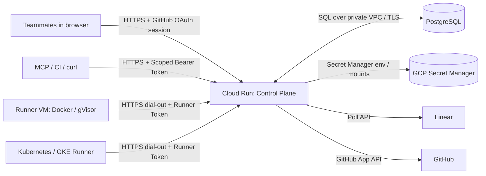

# Production Team Deployment: Cloud Run, PostgreSQL, and Public Auth

*   **Author:** Owain Lewis
*   **Status:** Proposed
*   **Date:** 2026-11-26
*   **Issues:** ENG-213, ENG-178

--------------------------------------------------------------------------------

## Overview

Machinist started as a single binary on a laptop or a private VM, backed by a local SQLite
file and accessed over an SSH tunnel with a pasted bearer token. That setup is great for a
solo developer or a quick evaluation, and we should keep it simple and cheap.

For a **team** — the real target of Machinist — that model hits four walls quickly:

1. **No shared HTTPS URL.** Teammates cannot click a link from Slack, Linear, or a pull
   request if the UI only lives on `127.0.0.1:7331` behind an SSH tunnel.
2. **No real human login.** Minting, copying, and revoking long-lived bearer tokens by hand
   does not scale past two or three people, and exposes a powerful credential if the control
   plane is reachable on the public internet.
3. **SQLite ties the control plane to one disk.** A single local SQLite file prevents
   stateless container deploys (such as Google Cloud Run), zero-downtime rolling upgrades,
   managed point-in-time recovery, and clean write concurrency as multiple runners stream
   live step events.
4. **Mutable config on a VM drifts.** Editing `config.yaml` and `factory/` over SSH means
   production state diverges from git.

This design defines two first-class deployment tiers, keeps the single-VM SQLite path
intact, and specifies the **PostgreSQL backend**, **immutable image packaging**, and
**public-facing authentication & security model** required to run Machinist's control plane
safely on Google Cloud Run (with runners on VMs, Docker/gVisor, or Kubernetes).

--------------------------------------------------------------------------------

## Deployment Tiers

Machinist explicitly supports two tiers from the same binary:

| Dimension | Quickstart / Self-Hosted VM | Production Team (Cloud Run) |
| --- | --- | --- |
| **Control plane host** | Laptop or cheap Linux VM (e.g. Hetzner, `e2-small`) | Google Cloud Run Service (`min=1`, `--no-cpu-throttling`) |
| **Database** | SQLite (`.machinist/tickets.db`) | PostgreSQL (`DATABASE_URL` — Cloud SQL, Neon, RDS, or self-hosted) |
| **TLS & URL** | Localhost / SSH tunnel, or reverse proxy (Caddy) | Managed HTTPS + custom domain via Cloud Run |
| **Config & `factory/`** | Checked out on disk (hot-reload via `machinist reload`) | Baked into the container image (immutable GitOps deploys) |
| **Human login** | Operator bearer token (or optional OAuth) | **GitHub OAuth** (with optional OIDC / Cloud IAP) |
| **Machine auth** | Bearer tokens (`--runner`, `--scope read|run`) | Bearer tokens (`--runner`, `--scope read|run`) |
| **Runners** | Local or Docker (`runsc`) on the same VM | Dial-out VMs (Docker/gVisor), GKE, or future Cloud Run Jobs |



Runners always dial **out** to the control plane over HTTPS. Putting the control plane on
Cloud Run with automatic TLS means runners on a cheap Hetzner box, a GCP VM, a developer
laptop, or a GKE cluster can all connect to one stable endpoint with no inbound ports open
on any runner host.

--------------------------------------------------------------------------------

## 1. PostgreSQL as the Production Database

SQLite stays as the zero-setup default when `DATABASE_URL` is unset (`server.database:
.machinist/tickets.db`). For team deployments, PostgreSQL is the primary supported backend.

### Why PostgreSQL over SQLite + Litestream

- **Stateless containers & safe rolling deploys:** Cloud Run briefly overlaps old and new
  revisions during deployments. SQLite with Litestream requires strict single-writer
  fencing (`max-instances=1`, traffic cutover pauses) to avoid split-brain corruption;
  PostgreSQL handles overlapping revisions natively.
- **No write-lock contention under live event streaming:** Multiple runners posting
  `events.jsonl` batches every second, heartbeats, Linear polling, PR Steward checks, and
  dashboard queries contend on SQLite's single writer lock. PostgreSQL MVCC eliminates
  `SQLITE_BUSY` under load.
- **Managed durability:** Cloud SQL (or Neon / Supabase / RDS) provides automated backups,
  point-in-time recovery, encryption at rest, and private VPC connectivity out of the box.

### Configuration & Driver Design

- Selection is explicit and backward-compatible:
  - If `DATABASE_URL` (env) or `server.database_url` (config, env-expanded only — never
    hardcoded credentials in git) starts with `postgres://` or `postgresql://`, `tickets.Open`
    opens PostgreSQL via `pgx/v5/stdlib` (or native `pgxpool`).
  - Otherwise `tickets.Open` opens SQLite at `server.database` exactly as today.
- **Keep one SQL layer where practical, with a thin dialect shim:**
  - Parameter rebinding (`?` → `$1, $2, ...`), upsert syntax (`ON CONFLICT ... DO UPDATE`
    already works on both), `BIGSERIAL` vs `INTEGER PRIMARY KEY AUTOINCREMENT`, and explicit
    transaction isolation (`BEGIN` vs `BEGIN IMMEDIATE` / `SELECT ... FOR UPDATE SKIP LOCKED`
    for `ClaimRun`!).
  - Notice that `SELECT ... FOR UPDATE SKIP LOCKED` on PostgreSQL makes `ClaimRun` lock-free
    across concurrent runner polls and even multi-instance control planes later.
- **Schema migrations:**
  - Replace ad-hoc `addColumns` checks with a monotonic `schema_migrations(version INT PRIMARY KEY, applied_at TIMESTAMPTZ)` table that runs identically on both SQLite and PostgreSQL on startup (protected by a Postgres advisory lock `pg_advisory_lock` so two overlapping Cloud Run revisions never race during migration).
- **Test parity:**
  - Every `internal/tickets` test runs against SQLite by default and against PostgreSQL when
    `TEST_POSTGRES_URL` is set in CI (mirroring how `airtime` tests both SQLite and
    PostgreSQL).

### Background Loops on Cloud Run

Machinist's control plane runs four periodic background loops:

1. **Linear poller** (every 60s)
2. **PR watcher & PR Steward** (`engine.CheckPRs`, every 30–60s)
3. **Automation scheduler** (every 60s)
4. **Run lease reaper** (checks expired 10-minute runner leases)

On Cloud Run:

- Run with **`min-instances=1`**, **`max-instances=1`** (initially, until leader election
  is added), and **`--no-cpu-throttling`** (instance-based billing) so background goroutines
  never freeze between HTTP requests.
- During a brief rolling deploy where two Cloud Run revisions overlap for a few seconds,
  use a **PostgreSQL session advisory lock** (`pg_try_advisory_lock`) around the background
  scheduler/poller loop so only one revision polls Linear, ticks schedules, or invokes
  `CheckPRs` at a time. This makes zero-downtime deploys safe immediately and lays the
  groundwork for `max-instances > 1` later.

--------------------------------------------------------------------------------

## 2. Baking `config.yaml` and `factory/` Into the Image

For Cloud Run deployments, **`config.yaml` and `factory/` are baked into the container
image** rather than mounted from a mutable bucket or edited over SSH.

### Why immutable images win for teams

- **Git is the single source of truth:** Every change to a preset, agent prompt, merge
  policy, automation schedule, or Linear project mapping goes through a pull request and
  produces a versioned container image.
- **Zero runtime drift & instant rollback:** Rolling back a bad prompt or config change is a
  single Cloud Run revision rollback (`gcloud run services update-traffic`).
- **Simple operations:** No GCS FUSE mounts, no sync sidecars, no startup race conditions.
  `machinist reload` remains available for self-hosted VM installs where files live on disk.

### Reference `Dockerfile` pattern

A team's own machinist-config repository builds a minimal image on top of the official
Machinist release image. Because `internal/ghclient` currently shells out to `gh` (including
`gh pr checks --json`, which requires a recent GitHub CLI release newer than Debian
Bookworm's default `2.23.0` package), the official `ghcr.io/owainlewis/machinist` base image
bundles both `machinist` and a pinned recent `gh` binary (we can drop `gh` and move to
`distroless/static` later if `internal/ghclient` is migrated to direct Go HTTP calls):

```dockerfile
FROM ghcr.io/owainlewis/machinist:latest AS bin

FROM debian:bookworm-slim
RUN apt-get update \
    && apt-get install -y --no-install-recommends ca-certificates \
    && rm -rf /var/lib/apt/lists/* \
    && useradd --system --home /srv/machinist --shell /usr/sbin/nologin machinist
COPY --from=bin /usr/local/bin/machinist /usr/local/bin/machinist
COPY --from=bin /usr/local/bin/gh /usr/local/bin/gh
WORKDIR /srv/machinist
COPY --chown=machinist:machinist config.yaml /srv/machinist/config.yaml
COPY --chown=machinist:machinist factory/ /srv/machinist/factory/
USER machinist
EXPOSE 8080
ENTRYPOINT ["/usr/local/bin/machinist", "start", "--config", "/srv/machinist/config.yaml"]
```

### Strict rule: zero secrets in the image

No secret may ever be copied into the image or committed to `config.yaml`:

| Secret | How it enters Cloud Run |
| --- | --- |
| `DATABASE_URL` | GCP Secret Manager → env var |
| `GITHUB_APP_PRIVATE_KEY` (or file mount) | GCP Secret Manager → mounted read-only file `/run/secrets/github-app.pem` (or env var) |
| `GITHUB_OAUTH_CLIENT_ID` / `GITHUB_OAUTH_CLIENT_SECRET` | GCP Secret Manager → env vars |
| `LINEAR_CLIENT_ID` / `LINEAR_CLIENT_SECRET` | GCP Secret Manager → env vars |
| `SESSION_SECRET` (optional HMAC/signing key if needed) | GCP Secret Manager → env var |
| `NOTIFY_WEBHOOK_URL` | GCP Secret Manager → env var |
| Model keys (`ANTHROPIC_API_KEY`, `OPENAI_API_KEY`, etc.) | **Never on the control plane** — live only on runners |

Note: `server.listen` should honor Cloud Run's `$PORT` environment variable (e.g.
`listen: ":8080"` or `PORT` fallback) so the same config works cleanly in containers.

--------------------------------------------------------------------------------

## 3. Public Control-Plane Security Model & Login Architecture

Exposing Machinist on a public HTTPS URL (`https://machinist.example.com`) fundamentally
changes its threat model compared to `127.0.0.1:7331`.

### Threat Model: What an attacker gains if they breach the control plane

As [SECURITY.md](../../SECURITY.md) notes, **an operator session on Machinist is equivalent
to write access to every connected repository and code execution on every connected runner**:

- An authenticated operator can submit a job whose prompt asks an agent to exfiltrate a
  runner's environment, inspect private repositories, or open pull requests.
- An authenticated operator can read all job logs, diffs, prompts, and run histories (which
  frequently contain proprietary source code and error traces).
- A compromised runner token can claim runs and receive short-lived GitHub App tokens for
  connected repositories, and inject arbitrary step events/results.

Therefore, **public exposure requires defense in depth across identity, transport,
sessions, route isolation, and abuse controls.**

---

### Authentication Architecture: Three Separate Planes

Do not conflate human browser logins, runner daemons, and API/MCP bots into one auth path.

| Plane | Caller | Auth mechanism | Allowed routes |
| --- | --- | --- | --- |
| **1. Human UI** | Team members in a browser | **GitHub OAuth** (or OIDC) → opaque server-side session cookie | `/api/v1/*` (UI routes), `/machinist/*` |
| **2. Runners** | `machinist runner start` daemons | `Authorization: Bearer <runner-token>` **only** (cookies rejected) | `/api/v1/runner/*` **only** |
| **3. Bots / Automation** | MCP clients, CI scripts, `curl` | `Authorization: Bearer <scoped-token>` **only** (cookies rejected on `/mcp`) | `/mcp`, `/machinist/*` (enforced by `read` / `run` / full scope) |

#### Why GitHub OAuth is the right default for human login (ENG-178)

Every Machinist team already has GitHub accounts and GitHub org/team structure:

1. **Zero out-of-band token sharing:** Teammates click **Sign in with GitHub**; no admin
   ever pastes a bearer token into Slack.
2. **Real identity & attribution:** Jobs, reruns, cancellations, and token creations record
   the GitHub login (`owainlewis`) instead of a shared label, making Dashboard metrics and
   audit logs accurate.
3. **Automatic offboarding:** Authorization checks run on login and periodically (or on
   session revalidation). Removing a user from `auth.github.allowed_users` or the configured
   GitHub org/team revokes their ability to sign in (and an admin can immediately revoke
   their active sessions).
4. **Works everywhere:** Unlike GCP Cloud IAP alone, built-in GitHub OAuth works on Cloud
   Run, AWS, Fly.io, and self-hosted Caddy VMs alike, and **never interferes with
   non-browser runner or MCP bearer-token traffic**.

#### Authorization Policy (`config.yaml`)

Authentication ("who are you on GitHub?") must always be paired with explicit, fail-closed
**authorization** ("are you allowed into *this* Machinist instance?"):

```yaml
server:
  public_url: https://machinist.example.com

auth:
  # When true (required whenever auth.github is configured on a public instance),
  # browser sign-in via raw bearer token paste is disabled.
  disable_token_signin: true
  github:
    client_id_env: GITHUB_OAUTH_CLIENT_ID
    client_secret_env: GITHUB_OAUTH_CLIENT_SECRET
    # Fail closed: at least one allowlist rule is required at startup.
    allowed_users:
      - owainlewis
    # Optional: allow members of specific GitHub orgs or org/team slugs.
    # Requires read:org scope on the OAuth app when set.
    allowed_orgs:
      - gradientwork
    allowed_teams:
      - gradientwork/engineering
```

**Startup fail-closed rules:**

- If `auth.github` is configured with empty `allowed_users`, `allowed_orgs`, and
  `allowed_teams`, the control plane **refuses to start** (prevents accidentally allowing
  every GitHub user on Earth!).
- If `server.public_url` is set to a non-loopback `https://` URL and **no** `auth.github`
  (or `auth.oidc`) is configured, log a prominent startup warning (and optionally require
  explicit opt-in such as `auth.allow_token_only_public: true`) so nobody accidentally
  exposes token-paste login to the public internet without realizing it.
- Keep `auth.github` OAuth scopes minimal: `read:user` when using `allowed_users` only,
  adding `read:org` only when `allowed_orgs` or `allowed_teams` is configured. Never request
  `repo` scope on the user's OAuth login — Machinist acts on repos via the GitHub App, not
  the signed-in human's OAuth token. Discard the GitHub OAuth access token after fetching
  identity/membership (do not persist human GitHub access tokens in the database).

#### Optional Edge Auth: Google Cloud IAP & OIDC

Teams standardized on Google Workspace or Okta have two clean options:

- **Option A — Built-in OIDC (`auth.oidc`):** Future addition alongside `auth.github` using
  standard Authorization Code + PKCE (Google Workspace, Okta, Entra ID), writing into the
  exact same `sessions` table and user model.
- **Option B — Cloud IAP in front of Cloud Run (defense in depth):**
  - **Important pitfall:** If Cloud IAP sits in front of the *entire* Cloud Run service,
    IAP intercepts unauthenticated requests with a `302` redirect to Google Sign-In — which
    breaks **runners** (`/api/v1/runner/*`) and **MCP/API clients** (`/mcp`, `/machinist/*`)
    unless those callers mint Google OIDC identity tokens for IAP's audience.
  - Therefore, teams using IAP should either:
    1. Keep Machinist's own GitHub OAuth + bearer token auth as the application boundary on
       Cloud Run (no IAP required, all runners/MCP clients work out of the box), **or**
    2. Use IAP **only** if they also configure IAP service-account OIDC tokens on runners or
       split UI traffic from runner/API traffic at the Load Balancer URL map.

---

### Concrete Security Hardening Required Before Going Public

Auditing `internal/controlplane/auth.go` against a public Cloud Run deployment surfaces
several concrete changes we must implement before exposing a control plane publicly:

#### 1. Dedicated `sessions` table (never put bearer tokens in cookies)
Today `auth.go:101` stores the raw bearer token directly inside `machinist_session`. With
OAuth sign-in:
- Create a `sessions` table (`id`, `token_hash`, `user_login`, `user_name`, `provider`,
  `created_at`, `last_seen_at`, `expires_at`, `revoked_at`).
- Issue a cryptographically random 32-byte opaque session token, store only its SHA-256 hash
  in `sessions`, and never reuse API/operator bearer tokens as browser cookies.
- Enforce both an **idle/sliding timeout** (e.g. 7 days) and an **absolute maximum
  lifetime** (e.g. 30 days). Signing out revokes the session row in the database immediately.
- Show active sessions in Settings (or `machinist session list` / `revoke`) so an admin can
  terminate a compromised browser session or offboard a teammate instantly.

#### 2. Proxy-aware `Secure` & `__Host-` session cookies
Today `auth.go:110` sets:
```go
Secure: s.state().config.Server.TLSCert != "" || (r != nil && r.TLS != nil)
```
On Cloud Run (and behind Caddy/ALB/nginx), TLS terminates at the load balancer so `r.TLS` is
`nil` inside the Go container! That would silently emit an **insecure** cookie over public
HTTPS.
- Fix: Treat the deployment as HTTPS whenever `server.public_url` starts with `https://`,
  `TLSCert != ""`, or `r.TLS != nil`.
- When HTTPS is active, set `Secure: true`, `HttpOnly: true`, `Path: "/"`, and prefix the
  cookie name as **`__Host-machinist_session`** (browser-enforced protection against
  subdomain cookie tossing and non-HTTPS downgrade).

#### 3. OAuth flow hardening & CSRF protection
- **OAuth `state` + PKCE (`S256`):** Generate a random `state` and PKCE `code_verifier`,
  bind `state` to a short-lived (10-minute), `HttpOnly`, `Secure`, `SameSite=Lax` cookie,
  and verify exact match on `/auth/github/callback` before exchanging the code. Prevent
  login-CSRF and open redirects (validate any post-login return path is a relative `/...` or
  `#/...` fragment).
- **Cookie `SameSite=Lax` + strict CSRF check on mutations:**
  - Switching the session cookie from `Strict` to `Lax` ensures clicking a link from Slack,
    Linear, or GitHub into `https://machinist.example.com/#/jobs/t_...` stays signed in on
    initial navigation.
  - Pair `SameSite=Lax` with a mandatory **same-origin middleware** on every cookie-authenticated
    non-safe request (`POST`, `PUT`, `PATCH`, `DELETE`): verify `Origin` (or `Sec-Fetch-Site:
    same-origin`) matches `server.public_url` / `Host`. Reject missing or mismatched origins
    with `403`.
- **No cookie auth on machine endpoints:**
  - `handleMCP` already uses `bearerToken(r)` only.
  - Tighten `requireRunner` (`auth.go:79`) from `requestToken(r)` to `bearerToken(r)` so
    runner routes never accept browser cookies.

#### 4. Public surface minimization & transport headers
- **Unauthenticated routes stay strictly minimal:** Only `/healthz` (consider omitting
  exact version or keeping minimal `{"ok":true}` when public), `/auth/github/*`, static
  frontend shell assets, and `GET /api/v1/auth/status` (returns only `{authenticated: false,
  methods: ["github"]}` — never leaking repo names, user lists, or setup status before login).
- **Security headers middleware** on every HTTP response:
  - `Strict-Transport-Security: max-age=31536000; includeSubDomains` (when HTTPS)
  - `Content-Security-Policy: default-src 'self'; ...` (no inline scripts, `frame-ancestors 'none'`)
  - `X-Content-Type-Options: nosniff`
  - `Referrer-Policy: no-referrer` (prevents leaking job URLs or OAuth callback params)
- **Rate limiting:**
  - Per-IP sliding-window rate limits on `/auth/*`, `/api/v1/auth/signin`, and failed
    bearer-token attempts (401s) to block token/OAuth brute-forcing and log flooding.
  - On Cloud Run, optionally layer **Cloud Armor** in front of an External HTTPS Load
    Balancer for DDoS/WAF protection and optional IP allowlisting for private corporate VPNs.

#### 5. Audit logging & runner token hygiene
- Log structured JSON audit events (compatible with Cloud Logging) for:
  - User sign-in / sign-out / rejected OAuth login (with GitHub handle & reason)
  - Token creation, regeneration, and revocation (actor + target token name/role/scope)
  - Job creation, rerun, and cancellation (actor + repo + job ID)
  - Project additions/removals
- **Runner tokens:** Never reuse one runner token across multiple hosts; issue one
  `machinist token create <host> --runner` per VM/cluster so a single compromised host can
  be revoked in seconds.
- **Bootstrap admin token on a fresh Cloud Run install:** When deploying for the first time
  with no interactive shell on the container, human login works immediately via
  `auth.github.allowed_users` (no bootstrap token needed for humans!). Once signed in via
  GitHub OAuth, an operator creates runner and MCP tokens directly in **Settings → Tokens**.

#### 6. Optional network tightening for high-security teams
Even on Cloud Run, you do **not** have to expose the control plane to the whole internet if
you don't need to:
- **Public with GitHub OAuth (recommended default for small/remote teams):** Works from
  anywhere, zero VPN friction, strong OAuth + session + CSRF + rate-limit boundary.
- **Public + Cloud Armor IP allowlist / Tailscale:** Restricts ingress to office/VPN/runner
  egress IPs while still keeping managed TLS.
- **Internal Cloud Run (`--ingress=internal`) + VPC:** Zero public ingress; team reaches UI
  via Tailscale/VPN subnet router and GCE/GKE runners talk over Private Google Access.

--------------------------------------------------------------------------------

## 4. Runner Topology Paired With Cloud Run

Because the control plane only exposes HTTPS and never executes repository code, runners can
be chosen independently of Cloud Run:

1. **Dedicated VM with Docker + gVisor (`runtime: runsc`)** *(recommended today)*:
   - Best when using Claude Code / Codex / `agy` subscription logins (`login: true`) or
     wanting low predictable cost (e.g. a single Hetzner or GCE VM running `docker:` with
     `runtime: runsc` dialing out to `https://machinist.example.com`).
2. **GKE Sandbox (`kuberunner`):**
   - Best for larger teams needing multi-node auto-scaling, strict egress proxy allowlists,
     and full pod isolation per run.
3. **Cloud Run Jobs (`cloudrunrunner`, future):**
   - Scale-to-zero gVisor execution for teams billed via API keys or Vertex AI who want
     zero idle runner cost and high overnight burst concurrency.

--------------------------------------------------------------------------------

## Rollout Plan

Each milestone ships cleanly on its own without breaking existing SQLite / VM installs:

1. **Milestone 1 — Public Auth & Session Hardening (ENG-178):**
   - `sessions` table, opaque hashed session cookies, proxy-aware `__Host-` `Secure` cookies,
     `SameSite=Lax` + Origin CSRF middleware, `requireRunner` bearer-only enforcement,
     security headers, rate limiting, and **GitHub OAuth** (`allowed_users`, `allowed_orgs`,
     `allowed_teams`, fail-closed startup).
   - Structured audit logging for auth and token actions.
2. **Milestone 2 — PostgreSQL Storage Backend:**
   - `DATABASE_URL` / `pgx` support in `internal/tickets/` alongside SQLite.
   - Versioned migrations with Postgres advisory lock, `FOR UPDATE SKIP LOCKED` in `ClaimRun`,
     and leader-lock around background loops (`CheckPRs`, Linear poller, schedules) for safe
     Cloud Run revision overlaps.
   - CI matrix running `internal/tickets` tests on both SQLite and PostgreSQL.
3. **Milestone 3 — Cloud Run Packaging & Docs:**
   - Official minimal control-plane container image (`Dockerfile` including `gh` + `ca-certificates`, `$PORT` support,
     Secret Manager env/file conventions; optional future `distroless` once `internal/ghclient`
     uses direct HTTP) with baked `config.yaml` + `factory/`.
   - Step-by-step `docs/cloud-run.md` deployment guide (Cloud Run + Cloud SQL or Neon +
     Secret Manager + custom domain + connecting a VM Docker/gVisor runner).
4. **Milestone 4 (Optional) — OIDC Login & Cloud Run Jobs Runner:**
   - Generic OIDC provider (`auth.oidc`) for Google Workspace / Okta / Entra ID.
   - `cloudrunrunner` backend for API/Vertex scale-to-zero execution.

--------------------------------------------------------------------------------

## Non-Goals

- **Dropping SQLite or single-VM hosting.** Solo developers and small teams should always be
  able to run `machinist init && machinist start` on a laptop or €20/month VM with zero
  external database.
- **Multi-tenant SaaS hosting inside one control plane.** One Machinist control plane still
  serves one team / trust domain (matching [SECURITY.md](../../SECURITY.md)).
- **Runtime editing of `config.yaml` or `factory/` from the web UI.** On Cloud Run,
  configuration changes happen via git commits and immutable image deploys.
