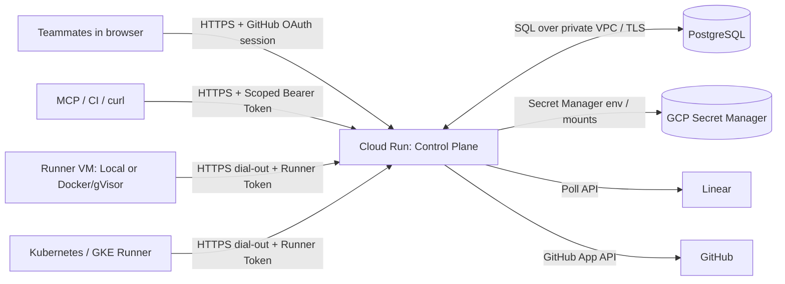

# Production Team Deployment: Cloud Run, PostgreSQL, and Public Auth

*   **Author:** Owain Lewis
*   **Status:** Proposed
*   **Date:** 2026-11-26
*   **Issues:** ENG-213, ENG-216, ENG-178
*   **Detailed Auth & Access Spec (Single Source of Truth):** [Spec 1: Identity and Access Control](identity-and-access.md) *(implemented)*
*   **Detailed PostgreSQL Storage Spec:** [Spec 2: PostgreSQL Storage Backend](postgresql-storage.md)
*   **Detailed Cloud Run Packaging Spec:** [Spec 3: Cloud Run Packaging & Production Guide](cloud-run-packaging.md)

--------------------------------------------------------------------------------

## Overview

Machinist started as a single binary on a laptop or a private VM, backed by a local SQLite
file and accessed over an SSH tunnel with a pasted bearer token. That setup is great for a
solo developer or a quick evaluation, and we keep it simple and cheap.

For a **team** — the target of Machinist — that model hits four walls quickly:

1. **No shared HTTPS URL.** Teammates cannot click a link from Slack, Linear, or a pull
   request if the UI only lives on `127.0.0.1:7331` behind an SSH tunnel.
2. **No real human login.** Minting, copying, and revoking long-lived bearer tokens by hand
   does not scale past a few people and exposes a powerful credential on the public internet.
3. **SQLite ties the control plane to one disk.** A local SQLite file prevents stateless
   container deploys (Google Cloud Run), zero-downtime rolling upgrades, managed point-in-time
   recovery, and clean write concurrency as runners stream live step events.
4. **Mutable config on a VM drifts.** Editing `config.yaml` and `factory/` over SSH lets
   production diverge from git.

This architecture defines two first-class deployment tiers, preserves the single-VM SQLite
path, and outlines the **PostgreSQL backend (Spec 2)** and **immutable Cloud Run packaging
(Spec 3)** that build directly on **[Spec 1: Identity and Access Control](identity-and-access.md)**.

--------------------------------------------------------------------------------

## Deployment Tiers

Machinist supports two tiers from the same binary:

| Dimension | Quickstart / Self-Hosted VM | Production Team (Cloud Run) |
| --- | --- | --- |
| **Control plane host** | Laptop or cheap Linux VM (e.g. Hetzner, `e2-small`) | Google Cloud Run Service (`min=1`, `--no-cpu-throttling`) |
| **Database** | SQLite (`.machinist/tickets.db`) | PostgreSQL (`DATABASE_URL` — Cloud SQL, Neon, RDS, or self-hosted) |
| **TLS & URL** | Localhost / SSH tunnel, or reverse proxy (Caddy) | Managed HTTPS + custom domain via Cloud Run |
| **Config & `factory/`** | Checked out on disk (hot-reload via `machinist reload`) | Baked into an immutable container image (GitOps deploys) |
| **Human login & team access** | Operator bearer token (or optional GitHub OAuth) | **GitHub OAuth + DB-managed invites + 3-role RBAC** ([Spec 1](identity-and-access.md)) |
| **Machine auth** | Bearer tokens (`--runner`, `--scope read\|run`) | Bearer tokens (`--runner`, `--scope read\|run`) |
| **Runners** | Bare-metal local (`login: true` or API keys) or Docker (`runsc`, API keys) | Dial-out VMs (bare-metal or Docker/`runsc`), GKE (`kuberunner`), or future Cloud Run Jobs |

*(Cost note: running Cloud Run with `min-instances=1` and `--no-cpu-throttling` plus managed
PostgreSQL is materially more expensive than a ~\$20/month single VM with Caddy, trading raw
compute cost for managed TLS, Secret Manager, zero OS patching, and managed DB backups.)*



Runners always dial **out** to the control plane over HTTPS. Putting the control plane on
Cloud Run with automatic TLS lets runners on a cheap VM, a developer laptop, or a GKE cluster
all connect to one stable endpoint with zero inbound ports open on any runner host.

--------------------------------------------------------------------------------

## 1. PostgreSQL as the Production Database (Spec 2)

SQLite remains the zero-setup default when `DATABASE_URL` is unset (`server.database:
.machinist/tickets.db`). For team deployments, PostgreSQL is the production backend.

### Why PostgreSQL over SQLite + Litestream

- **Safe Cloud Run rolling deploys:** Cloud Run overlaps old and new revisions briefly during
  deployments. SQLite + Litestream requires strict single-writer fencing to prevent
  split-brain corruption; PostgreSQL handles overlapping revisions natively.
- **No write-lock contention under live event streaming:** Multiple runners posting step
  event batches every second, heartbeats, Linear polling, PR Steward checks, and dashboard
  queries contend on SQLite's single writer lock. PostgreSQL MVCC eliminates `SQLITE_BUSY`.
- **Managed durability:** Cloud SQL (or Neon / RDS) provides automated backups, point-in-time
  recovery, and private VPC connectivity out of the box.

### Required SQLite → PostgreSQL Portability Work

Auditing `internal/tickets/` shows that a naive `?` → `$N` shim is **not** enough — Spec 2
must explicitly address these live SQLite-only constructs:

1. **Remove `rowid` dependencies (6 queries):** `internal/tickets/store.go` (lines 513, 1018,
   1243, 1282, 1385) and `progress.go` (line 114) rely on SQLite's implicit `rowid`. Replace
   with explicit indexed ordering (`queued_at, id` or monotonic sequence columns).
2. **Redesign `ClaimRun` (`store.go:1325–1385`) for PostgreSQL:** `firstAccepted` paginates
   with `LIMIT/OFFSET` and filters candidates in Go via `accept(ticket)`. Injecting
   `FOR UPDATE SKIP LOCKED` over that query is invalid SQL and locks skipped candidate rows,
   starving concurrent runners. Instead, evaluate eligible queued runs unlocked and claim the
   chosen run atomically via `UPDATE runs SET status='running', ... WHERE id=$1 AND
   status='queued' RETURNING ...` (retrying on 0 rows).
3. **Replace SQLite-only SQL functions & types:**
   - `group_concat(...)` (`reports.go:39`) → `string_agg` on Postgres (or aggregate in Go).
   - `COLLATE NOCASE` (`store.go:102` on `projects.repo`) → functional `LOWER(repo)` unique
     index + targetless `ON CONFLICT DO NOTHING` + `ORDER BY LOWER(repo), repo` (preserving
     original casing).
   - `BLOB` (`store.go:103` on `run_patches.body`) → `BYTEA` on Postgres (plus `DOUBLE PRECISION`
     for `cost`, `BIGINT` for `tokens`/`duration_millis`/`sequence`, and `CAST(SUM(tokens) AS BIGINT)`).
   - `substr(<ts>, 1, 10)` (`usage.go:28`, `stats.go`) and `coalesce(last_used_at, '') < ?`
     (`store.go:2009, 2018`) → use `(last_used_at IS NULL OR last_used_at < ?)` with canonical
     fixed-width UTC RFC3339Nano `TEXT` timestamps preserving nanosecond precision.
4. **Bypass filesystem helpers for `postgres://` URLs:** `tickets.Open` (`store.go:365`)
   calls `os.MkdirAll` / `os.Chmod`, and `config.LoadConfig` (`config.go:362–377`) calls
   `resolveConfigPath` on `server.database`. Route `DATABASE_URL` cleanly through
   `pgx/v5/stdlib` (`QueryExecModeExec` for pooler safety) without touching local paths.
5. **Versioned, expand-and-contract migrations:**
   - Use a monotonic `schema_migrations(version INT PRIMARY KEY, applied_at ...)` table.
   - Protect startup migrations with a transaction-scoped **`pg_advisory_xact_lock`** on a
     pinned direct connection (`db.Conn` / direct URL, safe even when app traffic uses a
     pooler).
   - Enforce **expand-and-contract** migration rules so the N-1 Cloud Run revision never
     crashes while serving traffic alongside a freshly migrated N revision.
6. **Test parity:** Run the full `internal/tickets` test suite against both SQLite and
   PostgreSQL in CI when `TEST_POSTGRES_URL` is set.

### Background Loops & Leader Leases on Cloud Run

Machinist's control plane runs **five** periodic background loops:

1. **Engine tick & lease reaper** (`Engine.Tick`, every `1s` — expires 10-minute runner
   leases and queues runs for waiting tickets)
2. **GitHub comment outbox** (`Engine.runDeliveries`, every `1s` — posts queued GitHub
   comments; explicitly non-idempotent across races)
3. **Automation scheduler** (`scheduleInterval`, every `30s`)
4. **Linear poller** (every `60s`)
5. **PR watcher & PR Steward** (`Engine.CheckPRs`, every `60s`)

On Cloud Run:
- Run with **`min-instances=1`**, **`max-instances=1`**, and **`--no-cpu-throttling`**
  (instance-based billing) so background goroutines never freeze between HTTP requests.
- **Leader lease (NOT session advisory locks):** Session advisory locks (`pg_try_advisory_lock`)
  break on Go connection pools and on PgBouncer/Neon transaction pooling. Instead, guard all
  five background loops behind a lightweight **`leader_leases(name PRIMARY KEY, holder_id,
  lease_expires_at)`** table renewed every 15s with a 45s TTL. That prevents duplicate
  comment posts, double Linear polls, or racing PR Steward merges during rolling Cloud Run
  overlaps and works identically across Cloud SQL, RDS, and Neon pooled endpoints.
- **10-second `SIGTERM` shutdown budget:** Cloud Run sends `SIGKILL` 10s after `SIGTERM`.
  Split `server.go`'s shutdown budget cleanly (e.g., `6s` HTTP drain + `3s` background loop
  cancellation and explicit leader-lease release) and set sensible HTTP server timeouts.

--------------------------------------------------------------------------------

## 2. Baking `config.yaml` and `factory/` Into the Image (Spec 3)

For Cloud Run deployments, **`config.yaml` and `factory/` are baked into an immutable
container image** rather than mounted from a mutable bucket or edited over SSH.

- **Git is the source of truth:** Every change to a preset, agent prompt, merge policy,
  automation schedule, or Linear project mapping goes through a pull request and builds a
  versioned image.
- **Instant rollback & zero drift:** Rolling back a bad prompt or config change is a single
  Cloud Run revision rollback (`gcloud run services update-traffic`).
- **Team onboarding still needs zero redeploys:** Because human users, roles, and invites
  live in the database ([Spec 1](identity-and-access.md)), adding or offboarding a teammate
  happens immediately in **Settings → Team** without touching the container image.
- `machinist reload` remains supported for self-hosted VM installs where files live on disk
  (and is a safe no-op on immutable containers).

### Reference `Dockerfile` Pattern

Machinist ships a dedicated lean Cloud Run control-plane image (`deploy/cloudrun/Dockerfile`,
bundling only `machinist`, `ca-certificates`, and a SHA-256-verified `gh` CLI with no `curl`
or `kubectl`, distinct from `deploy/kubernetes/control-plane.Dockerfile`).

Spec 3 publishes that official base image on each release (`ghcr.io/owainlewis/machinist:vX.Y.Z`)
with non-root `USER 1000:1000`, read-only `/srv/machinist`, `GH_CONFIG_DIR=/tmp/gh`, and
`ENTRYPOINT` pre-configured. A team's own config repository then needs only a 3-line `Dockerfile`
pinned to a release tag (never `:latest`), pushed to Artifact Registry for Cloud Run:

```dockerfile
FROM ghcr.io/owainlewis/machinist:v0.6.0
COPY --chmod=0644 config.yaml /srv/machinist/config.yaml
COPY --chmod=0755 factory/ /srv/machinist/factory/
```

*(We can drop `gh` and move the base image to `distroless/static` later if `internal/ghclient`
migrates from `exec.CommandContext("gh", ...)` to direct Go HTTP calls.)*

### Strict Rule: Zero Secrets in the Image

No secret may ever be baked into the image or committed to `config.yaml`:

| Secret | How it enters Cloud Run | Notes |
| --- | --- | --- |
| `DATABASE_URL` | GCP Secret Manager → env var | Added in Spec 2 |
| GitHub App PEM | GCP Secret Manager → mounted read-only file `/run/secrets/github-app.pem` | Supported today via `github.app.private_key_file` |
| `GITHUB_OAUTH_CLIENT_ID` / `GITHUB_OAUTH_CLIENT_SECRET` | GCP Secret Manager → env vars | Fixed env vars matching `LINEAR_*` (Spec 1) |
| `LINEAR_CLIENT_ID` / `LINEAR_CLIENT_SECRET` | GCP Secret Manager → env vars | Supported today |
| `MACHINIST_BOOTSTRAP_ADMIN` | Cloud Run env var (optional, one-time) | Inert forever after first admin signs in (Spec 1) |
| `NOTIFY_WEBHOOK_URL` | GCP Secret Manager → env var | Add env fallback for `notify.webhook` in Spec 3 |
| Model keys (`ANTHROPIC_API_KEY`, `OPENAI_API_KEY`, etc.) | **Never on the control plane** — live only on runners | — |

**Cloud Run runtime conventions (Spec 3):**
- When `$PORT` is set, `server.listen` is unset, and `K_SERVICE != ""` (or `server.public_url` is set), listen on `":" + PORT`.
- Bound concurrent GitHub lookups (`max 4` post-cache in `github_cache.go`) and process-wide `gh` subprocesses (`max 6` in `ghclient`) so large repo lists cannot exhaust Cloud Run container memory.

--------------------------------------------------------------------------------

## 3. Public Control-Plane Security Model

As [SECURITY.md](../../SECURITY.md) states, **an operator session on Machinist is equivalent
to write access to every connected repository and code execution on every connected runner.**

All authentication, session, invite, RBAC, CSRF, cookie, header, rate-limiting, and audit
requirements are defined in one place — **[Spec 1: Identity and Access Control](identity-and-access.md)**.
Key architectural boundaries for Cloud Run:

- **Three isolated auth planes:**
  1. **Human UI:** GitHub OAuth → opaque hashed `sessions` cookie (`__Host-machinist_session`,
     proxy-aware `Secure`, `SameSite=Lax`, Go stdlib `net/http.CrossOriginProtection` CSRF).
  2. **Runners:** `Authorization: Bearer <runner-token>` **only** (cookies ignored) on
     `POST /api/v1/runners/poll` and `POST /api/v1/runs/{id}/{heartbeat,events,complete,github-token}`.
  3. **Bots / MCP / CLI:** `Authorization: Bearer <scoped-operator-token>` on `/mcp`,
     `/machinist/*`, and `/api/v1/*` (cookies ignored on `/mcp`; `POST /api/v1/session`
     disabled on public OAuth installs).
- **Cloud IAP caveat:** Do **not** place Google Cloud IAP blindly in front of the entire
  Cloud Run service, or IAP's `302` browser login redirect will break dial-out runners
  (`POST /api/v1/runners/poll`, `/api/v1/runs/{id}/*`) and `/mcp` clients unless they mint
  IAP OIDC tokens or route through a split Load Balancer URL map. Built-in GitHub OAuth +
  bearer token auth works cleanly on Cloud Run without IAP; teams wanting extra network
  isolation can layer **Cloud Armor IP allowlisting** or `--ingress=internal` + VPC/Tailscale.

--------------------------------------------------------------------------------

## 4. Runner Topology Paired With Cloud Run

Because the control plane never runs repository code and runners dial out over HTTPS, choose
runners independently of Cloud Run:

1. **Bare-metal local runner VM** *(best when using `login: true` subscription logins)*:
   - Note that `internal/config/runner.go:131` explicitly forbids combining `login: true`
     with `docker:`. If you authenticate Claude Code / Codex / `agy` via interactive
     subscription logins (`login: true`), run the native local runner under a dedicated
     unprivileged Linux user on a VM (Hetzner or GCE) dialing out to Cloud Run over HTTPS.
2. **Docker + gVisor runner VM (`docker:` with `runtime: runsc`)** *(best single-VM
   isolation with API keys / Vertex)*:
   - Ephemeral hardened containers per run (`--cap-drop=ALL`, `no-new-privileges`, memory/CPU/PID
     caps, optional `runsc` gVisor) using API keys in `runner.env`.
3. **Kubernetes / GKE Sandbox (`kuberunner`):**
   - Full per-run gVisor Pod isolation with egress proxy allowlists and multi-node scaling.
4. **Cloud Run Jobs (`cloudrunrunner`, future):**
   - Scale-to-zero gVisor execution for API / Vertex AI teams wanting \$0 idle cost and high
     overnight burst concurrency.

--------------------------------------------------------------------------------

## Rollout Plan

Each spec ships cleanly in order without breaking existing SQLite / VM installs:

1. **Spec 1 — Identity & Access Control (Focused v1 — ENG-216 / ENG-178):**
   - Slices 1–3 in [identity-and-access.md](identity-and-access.md): schema + public
     hardening (`__Host-` cookies, `CrossOriginProtection`, bearer-only runners, rate limits,
     extended `securityHeaders`), GitHub OAuth + DB-managed invites + one-time bootstrap, and
     3-role RBAC + **Settings → Team** + `slog` JSON audit logs.
2. **Spec 2 — PostgreSQL Storage & Concurrency (ENG-214):**
   - Remove SQLite-only SQL (`rowid`, `COLLATE NOCASE`, `group_concat`, `coalesce(ts,'')`),
     redesign `ClaimRun` for Postgres, add `DATABASE_URL` (`pgxpool`), add `schema_migrations`
     with `pg_advisory_xact_lock`, add `leader_leases` across all 5 background loops, and run
     CI tests against both SQLite and PostgreSQL.
3. **Spec 3 — Cloud Run Packaging & Production Guide (ENG-215):**
   - Publish versioned `ghcr.io/owainlewis/machinist` control-plane base images from
     `deploy/kubernetes/control-plane.Dockerfile`, honor `$PORT`, add `NOTIFY_WEBHOOK_URL`
     env fallback, budget the 10s `SIGTERM` shutdown, bound `gh` subprocess fanout, and write
     `docs/cloud-run.md`.
4. **Future (Spec 1b & Runners):**
   - Generic OIDC (`auth.oidc` — Google Workspace / Okta / Entra ID) + account linking +
     `linear_user_id` Dashboard attribution.
   - `cloudrunrunner` backend for API/Vertex scale-to-zero execution.

--------------------------------------------------------------------------------

## Non-Goals

- **Dropping SQLite or single-VM hosting.** Solo developers and small teams can always run
  `machinist init && machinist start` on a laptop or €20/month VM with zero external DB.
- **Multi-tenant SaaS inside one control plane in v1.** One control plane serves one team /
  trust domain.
- **Runtime editing of `config.yaml` or `factory/` from the web UI.** On Cloud Run, config
  changes happen via git commits and immutable image deploys.
